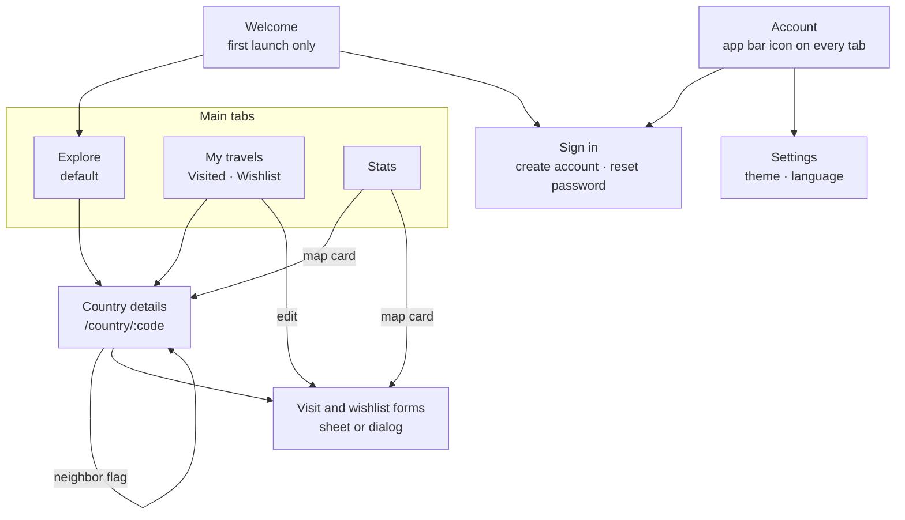
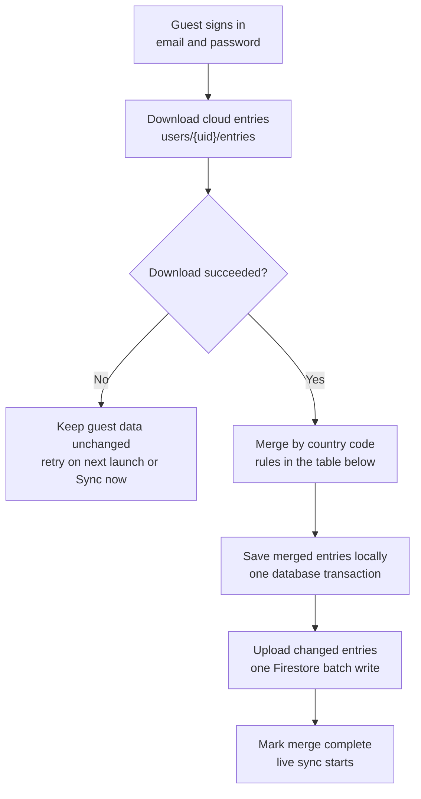
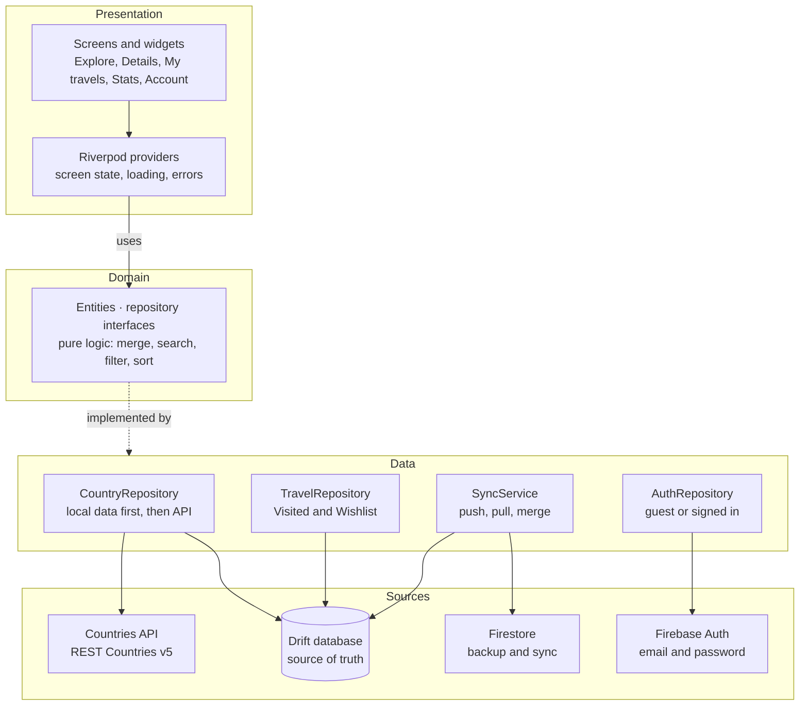
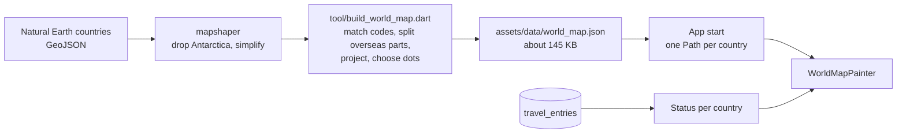

# بطوطة (Battuta): Product Requirements Document

**Every country, stamped.** · كل دولة، بختمها

A local-first app for exploring countries, recording trips, and planning the next one.

| Field | Value |
| --- | --- |
| Version | 1.15 |
| Status | Ready for development |
| Date | 27 October 2026 |
| Production platform | Web, at `battuta-travel.web.app` |
| Also built and tested | Android and iOS (not published in 1.0) |
| Technology | Flutter, Firebase |

### Revision history

| Version | Date | Change |
| --- | --- | --- |
| 1.15 | 27 Oct 2026 | My travels redesigned: Visited and Wishlist are a two-part toggle with counts, above the search and region chips, which show how many entries each region has. Each tab opens with a one-line summary. In the default order, visits fall under their years and wishlist entries under their priorities. Rows show a round flag, the rating or a priority tag, the region with the date or target year, and the first line of the notes; a missing date is left out (FR-TRV-05, FR-TRV-06, FR-TRV-08). Notes read in their own direction, so English notes on an Arabic screen keep their punctuation in place. |
| 1.14 | 27 Oct 2026 | Country details redesigned: the header's flag tint runs up behind the app bar, with the region tag and Open in Maps under the names; the save actions are full-width buttons or a status card; facts are tiles with shortened figures and a list; neighbors are round flags; and expanded screens show two columns (FR-DET-01 to 04, FR-DET-07). A visited country's stamp lands after the flag's flight instead of arriving with it (section 10.2). The visit and wishlist forms are redesigned: the country's flag in the header, a centered date choice, larger stars with words, priority options and year chips, a filled notes field, and a full-width Save (FR-TRV-01, FR-TRV-04). |
| 1.13 | 24 Oct 2026 | The app uses Alexandria, one typeface for Latin and Arabic, instead of Inter and IBM Plex Sans Arabic. Every app bar shows the app's name, centered (FR-PLT-09). Explore cards are circles filled with the flag, with the name and region over a soft dark gradient and a status badge on the edge (FR-EXP-01, FR-EXP-02). Flags elsewhere are framed like printed cards, and every flag decodes once at full size, so flights between screens draw it at once (NFR-03); on the way, the circle morphs into the framed shape. On the world map, tapping the selected country again or anywhere else on the page closes its card (FR-MAP-14), and a region's summary moved under the map (FR-MAP-24). A manual refresh says it can take up to a minute (FR-EXP-11). |
| 1.12 | 22 Oct 2026 | CI and production deploys set up with GitHub Actions (section 12.3). Every production deploy, from a version tag or the weekly run, fetches a fresh country snapshot first, and the weekly run redeploys the latest release, never unreleased code. The snapshot script stops without writing when data is missing or doesn't parse. The app version is 1.0.0. |
| 1.11 | 22 Oct 2026 | The map's Could items built: the color spread from the tap card, Replay my travels, and Share my map (FR-MAP-32 to 43). The replay's year label and Skip sit under the map, in place of its actions, so they cover no country; Replay is hidden when motion is reduced. The shared image is drawn straight to a canvas, not captured from the screen (section 11.5). The Israeli new shekel is left out with Israel (D-12). |
| 1.10 | 21 Oct 2026 | World map zoom, region focus, and the reveal built. The map handles its own gestures instead of `InteractiveViewer`, so the page still scrolls at 1× and the map pans once zoomed (section 11.5). Region bars on Stats are their own screen-reader items. |
| 1.9 | 21 Oct 2026 | World map added to the top of the Stats screen (section 6.10). The app draws it from bundled Natural Earth data in the Saudi point-of-view edition (D-11, section 8.7), so it needs no map service. The map card takes over the Stats headline and also shows when nothing is visited yet. About credits Natural Earth. Israel is left out of the app, and the map draws its area as Palestine (D-12). |
| 1.8 | 21 Oct 2026 | App icons generated for every platform from the logo. The iOS home-screen name follows the device language. Settings has an About section. Arabic dates now use Western digits too (D-5). |
| 1.7 | 20 Oct 2026 | Accounts and sync built. Security rules now also enforce last write wins and the entry shape. A new `local_data_owner` setting makes sure one account's entries never merge into another's after a session ends without Sign out. Sync is tested against the Firebase emulators. |
| 1.6 | 20 Oct 2026 | Flutter upgraded to 3.47.7. Drift 2.35.2 or newer is required on web, because older versions don't save transactions to IndexedDB. The web database worker is compiled from source. iOS builds with CocoaPods until Xcode 26.2 or later is available. |
| 1.5 | 20 Oct 2026 | Flags are bundled as assets because the flag CDN sends no CORS headers. A newer bundled snapshot replaces older local data. Search runs in memory, so `search_en` and `search_ar` are removed; `name_official_ar` is added (schema 2). Refresh attempt times are stored in `auto_refresh_at` and `manual_refresh_at`. `connectivity_plus` added; `cached_network_image` removed. |
| 1.4 | 20 Oct 2026 | Firebase project created as `battuta-b8451`. Production URL changed to `battuta-travel.web.app` because the `battuta` Hosting name was taken; the app name stays Battuta. App ID set to `com.ahmadalmudhi.battuta`. Firestore location set to `eur3`. |
| 1.3 | 20 Oct 2026 | Product renamed بطوطة (Battuta). Production URL changed to `battuta.web.app`. |
| 1.2 | 18 Oct 2026 | Product named Wanderstamp, with icon, colors, and typography. Production URL set to the free Firebase address. Release plan removed and open questions resolved. |
| 1.1 | 18 Oct 2026 | Web becomes the production platform; Android and iOS are built and tested but not published. Sign-in is email and password only. Country data loads from a bundled snapshot. |
| 1.0 | 18 Oct 2026 | First complete version |

## Contents

- [1. Introduction](#1-introduction)
    - [1.1 Purpose of this document](#11-purpose-of-this-document)
    - [1.2 Product summary](#12-product-summary)
    - [1.3 Conventions](#13-conventions)
    - [1.4 Brand identity](#14-brand-identity)
- [2. Goals and success criteria](#2-goals-and-success-criteria)
    - [2.1 Problem](#21-problem)
    - [2.2 Product goals](#22-product-goals)
    - [2.3 Release success criteria](#23-release-success-criteria)
- [3. Scope](#3-scope)
    - [3.1 In scope for 1.0](#31-in-scope-for-10)
    - [3.2 Out of scope](#32-out-of-scope)
    - [3.3 Key product decisions](#33-key-product-decisions)
- [4. Users](#4-users)
    - [4.1 User types](#41-user-types)
    - [4.2 Personas](#42-personas)
    - [4.3 User stories](#43-user-stories)
- [5. Information architecture](#5-information-architecture)
    - [5.1 Navigation map](#51-navigation-map)
    - [5.2 Screens and routes](#52-screens-and-routes)
- [6. Functional requirements](#6-functional-requirements)
    - [6.1 Onboarding (ONB)](#61-onboarding-onb)
    - [6.2 Explore (EXP)](#62-explore-exp)
    - [6.3 Country details (DET)](#63-country-details-det)
    - [6.4 My travels (TRV)](#64-my-travels-trv)
    - [6.5 Stats (STA)](#65-stats-sta)
    - [6.6 Accounts and authentication (AUTH)](#66-accounts-and-authentication-auth)
    - [6.7 Cloud backup and sync (SYNC)](#67-cloud-backup-and-sync-sync)
    - [6.8 Settings (SET)](#68-settings-set)
    - [6.9 Platforms and responsive layout (PLT)](#69-platforms-and-responsive-layout-plt)
    - [6.10 World map (MAP)](#610-world-map-map)
- [7. Key user flows](#7-key-user-flows)
    - [7.1 First launch](#71-first-launch)
    - [7.2 Mark a country as visited](#72-mark-a-country-as-visited)
    - [7.3 Merge guest data into an account](#73-merge-guest-data-into-an-account)
    - [7.4 Offline behavior](#74-offline-behavior)
- [8. Data requirements](#8-data-requirements)
    - [8.1 Country data source](#81-country-data-source)
    - [8.2 Snapshot and refresh rules](#82-snapshot-and-refresh-rules)
    - [8.3 Local data model](#83-local-data-model)
    - [8.4 Cloud data model](#84-cloud-data-model)
    - [8.5 Local settings](#85-local-settings)
    - [8.6 Validation rules and messages](#86-validation-rules-and-messages)
    - [8.7 World map data](#87-world-map-data)
- [9. Non-functional requirements](#9-non-functional-requirements)
- [10. Experience and interface requirements](#10-experience-and-interface-requirements)
    - [10.1 Visual design](#101-visual-design)
    - [10.2 Motion](#102-motion)
    - [10.3 Screen states](#103-screen-states)
    - [10.4 Localization and right-to-left](#104-localization-and-right-to-left)
- [11. Technical architecture](#11-technical-architecture)
    - [11.1 Overview](#111-overview)
    - [11.2 Technology stack](#112-technology-stack)
    - [11.3 Project structure](#113-project-structure)
    - [11.4 Platform configuration and secrets](#114-platform-configuration-and-secrets)
    - [11.5 World map rendering](#115-world-map-rendering)
- [12. Quality assurance](#12-quality-assurance)
    - [12.1 Test strategy](#121-test-strategy)
    - [12.2 Platform test matrix](#122-platform-test-matrix)
    - [12.3 CI pipeline](#123-ci-pipeline)
    - [12.4 Definition of done](#124-definition-of-done)
- [13. Assumptions, dependencies, and constraints](#13-assumptions-dependencies-and-constraints)
- [14. Risks and mitigations](#14-risks-and-mitigations)
- [15. Glossary](#15-glossary)
- [A. References](#a-references)

---

## 1. Introduction

### 1.1 Purpose of this document

This document defines what Battuta version 1.0 must do and how it must behave. It is the single source of truth for development: every feature is broken down into numbered requirements, each with a priority and testable acceptance criteria. Where this document and an implementation disagree, this document wins until it is updated.

### 1.2 Product summary

Battuta (بطوطة) is an app for browsing every country in the world, recording the countries a person has visited, seeing them on a world map, and keeping a wishlist of places to go next. It works fully without an account. Signing in with an email address backs up the user's data to the cloud and syncs it across their devices. The app is available in English and Arabic, with full right-to-left support, in light and dark themes.

The app is built with Flutter from one codebase for three platforms. The **web app is the production release** for version 1.0. The Android and iOS apps are built and tested from the same code and kept ready to publish, but they are not released to the stores yet.

### 1.3 Conventions

| Convention | Meaning |
| --- | --- |
| US-nn | User story: a need expressed from the user's point of view. |
| FR-AREA-nn | Functional requirement: something the app does. AREA names the module, for example EXP for Explore. |
| NFR-nn | Non-functional requirement: how well the app does it (performance, security, accessibility). |
| AC-AREA-nn | Acceptance criterion, written as Given / When / Then. A requirement is done only when its criteria pass. |
| Must | Required for release 1.0. The release cannot ship without it. |
| Should | Expected in 1.0. Can move to a later release only by an explicit product decision. |
| Could | Included only if time allows, after all Must and Should items are done. |

### 1.4 Brand identity

The product is named **بطوطة**, written **Battuta** in Latin letters. It is named after Ibn Battuta, the 14th-century traveler from Tangier and the best-known explorer in Arabic history. The name is short, instantly recognized by Arabic speakers, and easy to say in English. The Arabic name is the primary brand mark.

| Element | Specification |
| --- | --- |
| Name | Arabic: بطوطة. Latin: Battuta (double t in the middle). The name follows the interface language: بطوطة in Arabic and Battuta in English, including the Android launcher label and the iOS home-screen name. |
| Code identifiers | Flutter package name: `battuta`. Android application ID and iOS bundle ID: `com.ahmadalmudhi.battuta`. Firebase project ID: `battuta-b8451`. Hosting site: `battuta-travel`. These identifiers never appear in the interface; the app is always called Battuta (بطوطة). |
| Tagline | English: Every country, stamped. Arabic: كل دولة، بختمها |
| App icon | A cream passport stamp, tilted 12 degrees, with an amber globe at its center, on a Lagoon Teal background. The icon has no text, so it works in both languages. The artwork stays within the central 60% of the canvas, so round and rounded-square masks never clip it. Source files in `assets/icons/`: `battuta_logo.svg`, rendered to `battuta_icon.png` (1,024 px), plus the stamp alone (`battuta_icon_foreground.png`) and the background alone (`battuta_icon_background.png`) for the Android adaptive icon. Every platform size, including the web favicon, is generated with `flutter_launcher_icons` (`flutter_launcher_icons.yaml`). |
| Production URL | `battuta-travel.web.app`, a free Firebase Hosting address, which Firebase also serves at `battuta-travel.firebaseapp.com`. The names `battuta` and `battuta-app` were taken by other projects. The `-travel` suffix appears only in the web address, never in the app name. |
| Typography | Alexandria for all text, Latin and Arabic, including the بطوطة wordmark in Bold. One family designed for both scripts keeps Latin text on Arabic screens, such as capitals, matching the Arabic around it. It uses the SIL Open Font License and is bundled as assets in four weights, so the web app never fetches fonts at run time. |

#### Colors

| Name | Hex | Role |
| --- | --- | --- |
| Lagoon Teal | `#0E7C86` | Seed color for the Material 3 schemes: primary buttons, links, active navigation. White text on it has 4.95:1 contrast. |
| Stamp Amber | `#F2B24B` | Secondary color: the passport stamp, Visited badges, and progress bars. Use Deep Ink text on it (8.6:1). Never use it for text on white (1.9:1). |
| Passport Cream | `#FBEFD9` | Stamp artwork and light accent surfaces. |
| Deep Ink | `#13232B` | Text on amber and cream surfaces. |

Both themes are generated from the seed, with the amber secondary color fixed:

```dart
final lightScheme = ColorScheme.fromSeed(
  seedColor: const Color(0xFF0E7C86),
  secondary: const Color(0xFFF2B24B),
  onSecondary: const Color(0xFF13232B),
);
final darkScheme = ColorScheme.fromSeed(
  seedColor: const Color(0xFF0E7C86),
  brightness: Brightness.dark,
  secondary: const Color(0xFFF2B24B),
  onSecondary: const Color(0xFF13232B),
);
```

## 2. Goals and success criteria

### 2.1 Problem

People who travel keep track of their trips in notes, photos, or memory. They have no quick, private way to see which countries they have visited, how much of the world they have covered, and where they want to go next. Most tools that do this require an account up front, need a connection, or are not available in Arabic.

### 2.2 Product goals

| ID | Goal | How it is measured |
| --- | --- | --- |
| G-1 | Make any country fast to find | Search, filters, and sort update results within 100 ms after input settles (NFR-04). |
| G-2 | Make recording travel effortless | Marking a country as visited takes at most 3 taps or clicks from its details screen. |
| G-3 | Never require an account | Every feature except cloud backup works for guests. |
| G-4 | Never lose user data | Guest data survives sign-in, and a signed-in user's data appears on every device they sign in on. |
| G-5 | Work anywhere | The mobile apps work in airplane mode after the first launch; the web app keeps working if the connection drops (NFR-02). |
| G-6 | Feel native in both languages | Every screen passes the RTL checklist in section 10.4, with no untranslated text. |
| G-7 | Reach users with a link | The web app is live at a public URL, and the same code runs on Android and iOS (FR-PLT-01). |

### 2.3 Release success criteria

Release 1.0 is accepted when all of the following are true:

- All Must requirements are implemented and their acceptance criteria pass on web.
- The web app is live at `battuta-travel.web.app` on Firebase Hosting.
- The core flows in section 7 pass on Android and iOS on at least one device or simulator each.
- The CI pipeline (section 12.3) passes on the release commit.

## 3. Scope

### 3.1 In scope for 1.0

- **Onboarding:** a welcome screen with guest mode or sign-in.
- **Explore:** browse, search, filter, and sort every country.
- **Country details:** key facts, neighboring countries, and save actions.
- **My travels:** a Visited list and a Wishlist, with editing and deletion.
- **Stats:** a world map of visited and wishlist countries, plus progress overall and by region.
- **Accounts:** email and password sign-in, guest-to-account data merge, and cloud sync.
- **Settings:** theme and language.
- **Platforms:** web (production), Android and iOS (built and tested), from one Flutter codebase.
- **Responsive layout:** phone, tablet, and desktop browser widths, with mouse and keyboard support on web.

### 3.2 Out of scope

| Item | Reason |
| --- | --- |
| Publishing to Google Play and the App Store | Web is the only production platform for 1.0. The mobile builds stay release-ready. |
| Google, Apple, and other social sign-in | Email and password only for 1.0. Planned for a later release. |
| Multiple trips to the same country | One entry per country keeps the data model and merge simple. Candidate for 2.0. |
| Opening the web app with no connection (installable web app) | The web app needs a connection to load; it keeps working if the connection drops later. |
| Trip planning (itineraries, bookings, budgets) | A different product area. |
| Social features (sharing lists, following friends) | Needs privacy controls and moderation. |
| Photos, points of interest, and online map services (street maps, map tiles) | Need extra APIs, storage, and API keys. The world map (section 6.10) is drawn by the app from bundled data, so it needs none of these. |
| Push notifications | No time-sensitive features in 1.0. |
| Desktop apps (Windows, macOS, Linux) | The web app covers desktop use. |

### 3.3 Key product decisions

| ID | Decision | Rationale |
| --- | --- | --- |
| D-1 | The app is local-first: every screen reads from the on-device database. | Instant screens, offline support, and one code path for guests and signed-in users. |
| D-2 | Each country has at most one entry, either Visited or Wishlist. | No duplicates and a simple merge keyed by country code. |
| D-3 | Stats percentages use all countries and territories in the dataset (about 250) as the total. | Users can record any place in the dataset. The total is one constant, so it can change later. |
| D-4 | Signing out removes the user's entries from the device; the cloud copy stays. | Protects privacy on shared devices and browsers. |
| D-5 | Numbers use Western digits (0 to 9) in both languages. | Consistent with the API data and common in regional apps. Flutter's Arabic date data defaults to Arabic-Indic digits, so the app turns native digits off for Arabic dates. |
| D-6 | Conflicts between devices resolve by last write wins, per country. | Simple, predictable, and enough for one user's own devices. |
| D-7 | Web is the only production platform for 1.0. Android and iOS are built and tested but not published. | A link is the fastest way to reach users; store releases need extra review, assets, and accounts. |
| D-8 | Email and password is the only sign-in method in 1.0. | Works the same on all three platforms with no extra provider setup. |
| D-9 | Country data loads from a snapshot bundled with each build. The API only refreshes it. | Instant first load, and web traffic doesn't use up the shared API quota. |
| D-10 | The web app is served from the free Firebase Hosting address, battuta-travel.web.app. | No domain cost or DNS setup. A custom domain can be added later without code changes. |
| D-11 | The world map is drawn by the app from Natural Earth's 1:10m Saudi point-of-view edition, bundled with each build (section 8.7). | No map service, API key, or network use, so the map works offline and stays free. This edition includes every small country tested, makes the smallest complete map file, and draws disputed borders as recognized in the app's main region. Somaliland and Northern Cyprus are part of Somalia and Cyprus, which matches the dataset (section 8.1). Western Sahara is drawn as part of Morocco, so it has no shape of its own, though it still counts in Stats when marked as visited. Israel's area is drawn as Palestine (D-12). |
| D-12 | The app leaves out Israel. It isn't in the country data, Explore, Stats, or any country's neighbors, and the map draws its area as Palestine. | Follows the map's point of view (D-11). The parser skips Israel the way it skips records without ISO codes (section 8.1), so neither the bundled data nor a refresh brings it back, and data saved before this decision loses it at the next launch. The Israeli new shekel, which the data lists among Palestine's currencies, is left out too, so no screen or filter shows it. |

## 4. Users

### 4.1 User types

There are two user types. Both see the same app on every platform; only cloud features differ.

| Capability | Guest | Registered user |
| --- | --- | --- |
| Browse, search, filter, and sort countries | Yes | Yes |
| View country details | Yes | Yes |
| Manage Visited and Wishlist | Yes | Yes |
| View stats and the world map | Yes | Yes |
| Change theme and language | Yes | Yes |
| Back up data to the cloud | No | Yes |
| See the same data on web, Android, and iOS | No | Yes |

### 4.2 Personas

**The frequent traveler.** Has visited more than 20 countries and wants a clean record of them and a sense of progress. Uses ratings, notes, and the Stats screen most, usually on a phone.

**The planner.** Travels once or twice a year and spends months choosing where to go. Researches on a laptop browser, then checks the Wishlist on a phone while traveling.

### 4.3 User stories

| ID | User story | Priority | Requirements |
| --- | --- | --- | --- |
| US-01 | As a **guest**, I want to browse countries without creating an account, so I can use the app immediately. | Must | FR-ONB-01–02, FR-EXP-01 |
| US-02 | As a **traveler**, I want to search by name in English or Arabic, so I find a country fast. | Must | FR-EXP-03–05 |
| US-03 | As a **planner**, I want to filter by region, language, or currency and sort the results, so I find countries that match what I want. | Must | FR-EXP-06–09 |
| US-04 | As a **traveler**, I want to see a country's key facts and jump to its neighbors, so I learn about it and nearby places. | Must | FR-DET-01–06 |
| US-05 | As a **traveler**, I want to mark a country as visited with a date, rating, and notes, so I keep a record of my trips. | Must | FR-TRV-01–03 |
| US-06 | As a **planner**, I want to add countries to a wishlist with a priority and target year, so I can plan what's next. | Must | FR-TRV-04 |
| US-07 | As a **traveler**, I want to edit, delete, and undo changes to my entries, so mistakes are easy to fix. | Must | FR-TRV-05–10 |
| US-08 | As a **traveler**, I want to see how much of the world and each region I've visited, so I can track my progress. | Must | FR-STA-01–05 |
| US-09 | As a **guest**, I want to sign in with my email and keep everything I saved, so I never lose my data. | Must | FR-AUTH-01–03, FR-SYNC-01–03 |
| US-10 | As a **registered user**, I want the same data on all my devices, so my travels are backed up. | Must | FR-SYNC-04–07 |
| US-11 | As a **traveler**, I want to use the app in Arabic or English, in light or dark mode, so it feels natural to me. | Must | FR-SET-01–03 |
| US-12 | As a **planner**, I want the app to keep working without a connection, so I can use it while traveling. | Must | FR-EXP-10, NFR-02 |
| US-13 | As a **traveler**, I want to open the app in any browser or on my phone, so I can reach my travels from any device. | Must | FR-PLT-01–08 |
| US-14 | As a **traveler**, I want to see my visited and wishlist countries on a world map, so I can see where I've been at a glance. | Must | FR-MAP-01–15 |
| US-15 | As a **planner**, I want to zoom into a region of the map, so I can see what I've covered there and what's left. | Should | FR-MAP-16–25 |

## 5. Information architecture

### 5.1 Navigation map

The app has three main tabs. On compact screens they sit in a bottom bar; on wide screens they move to a side navigation rail (FR-PLT-02). Country details is the hub that every other part of the app links into.



*Figure 1. Navigation map. Arrows show where each screen leads. On web, every screen can also be opened directly by its URL.*

### 5.2 Screens and routes

On web, every route is a real URL that can be bookmarked, shared, and refreshed (FR-PLT-03).

| Screen | Route | Opened from | Notes |
| --- | --- | --- | --- |
| Welcome | `/welcome` | First launch only | Continue as guest, or Sign in |
| Explore | `/explore` | Main tab (default) | Grid, search, filters, sort |
| Country details | `/country/:code` | Explore card, My travels entry, Stats map card, neighbor flag, direct URL | :code is the 3-letter ISO code, for example /country/SAU |
| Visit form | Modal | Country details, Edit entry, Stats map card | Bottom sheet on compact screens, dialog on wider screens |
| Wishlist form | Modal | Country details, Edit entry, Stats map card | Bottom sheet on compact screens, dialog on wider screens |
| My travels | `/travels` | Main tab | Tabs: Visited (default) and Wishlist (?tab=wishlist) |
| Stats | `/stats` | Main tab | World map card, region bars, highlights |
| Account | `/account` | App bar icon on every tab | Guest view or signed-in view |
| Sign in | `/account/sign-in` | Welcome, Account | Email and password |
| Create account | `/account/sign-up` | Sign in |  |
| Reset password | `/account/reset` | Sign in | Sends a reset email |
| Settings | `/settings` | Account | Theme, language, about |

## 6. Functional requirements

Requirements are grouped by module. Each module lists its requirements, then the acceptance criteria that prove them. Unless a requirement names a platform, it applies to web, Android, and iOS.

### 6.1 Onboarding (ONB)

| ID | Requirement | Priority |
| --- | --- | --- |
| FR-ONB-01 | On first launch, the app shows a Welcome screen with two actions: **Continue as guest** and **Sign in**. | Must |
| FR-ONB-02 | Choosing Continue as guest opens Explore. The Welcome screen is never shown again on this device or browser. | Must |
| FR-ONB-03 | Choosing Sign in opens the Sign in screen. After a successful sign-in, the user lands on Explore. | Must |
| FR-ONB-04 | Country data is imported from the snapshot bundled with the app, so Explore is ready without any download (section 8.2). | Must |

| ID | Given | When | Then |
| --- | --- | --- | --- |
| AC-ONB-01 | a fresh install or a first visit to the website | the app opens | the Welcome screen appears. |
| AC-ONB-02 | the user chose Continue as guest | the app is reopened or the page is reloaded | Explore opens directly. |

### 6.2 Explore (EXP)

| ID | Requirement | Priority |
| --- | --- | --- |
| FR-EXP-01 | Show all countries in a scrolling grid: 2 columns on compact screens, 3 to 4 on medium screens, and up to 6 on expanded screens (FR-PLT-02). Each card is a circle filled with the flag, with the name in the app language, and the region. | Must |
| FR-EXP-02 | A card shows a round badge on its top end edge when the country is in Visited (check icon, Stamp Amber) or Wishlist (bookmark icon, teal). On web, hovering over a card lifts it. | Must |
| FR-EXP-03 | A search field filters the grid as the user types, 300 ms after typing stops. | Must |
| FR-EXP-04 | Search matches the English common name, English official name, and Arabic name as case-insensitive substrings, after normalization (section 10.4). | Must |
| FR-EXP-05 | Results whose name starts with the query rank above results that only contain it. Ties sort by name. | Should |
| FR-EXP-06 | A filter panel offers region (multi-select), subregion (multi-select, limited to the selected regions), language (single, searchable), and currency (single, searchable). | Must |
| FR-EXP-07 | Filters combine with AND across fields and OR within a field. The panel shows a live result count and a Clear all action. The toolbar shows the number of active filters. | Must |
| FR-EXP-08 | Sort options: name A to Z (default), name Z to A, population high to low or low to high, area high to low or low to high. | Must |
| FR-EXP-09 | Search text, filters, and sort stay applied while the user moves between screens, until the app or tab is closed. | Must |
| FR-EXP-10 | When the device is offline, a non-blocking banner reads: You're offline. Showing saved data. | Must |
| FR-EXP-11 | The user can refresh country data with pull to refresh on touch screens, or **Refresh data** in the Explore menu on web. Manual refresh calls the API at most once per hour (section 8.2). While the download runs, a message with a progress indicator reads: Updating country data. This can take up to a minute. The outcome replaces it. | Should |
| FR-EXP-12 | Loading, empty, and error states follow section 10.3. | Must |

| ID | Given | When | Then |
| --- | --- | --- | --- |
| AC-EXP-01 | the app is in English | the user types *sau* | Saudi Arabia appears in the results. |
| AC-EXP-02 | the app is in Arabic | the user types سعو | Saudi Arabia appears in the results. |
| AC-EXP-03 | region Europe and language French are selected | the grid updates | only European countries where French is spoken are shown, and the count matches. |
| AC-EXP-04 | the selected filters match no country | the grid updates | the empty state appears with a Clear filters button. |
| AC-EXP-05 | a fresh install of a mobile app with no network | Explore opens | all countries from the bundled data are shown with the offline banner. |
| AC-EXP-06 | filters are applied on Explore | the user opens Stats and returns | the same filters are still applied. |

### 6.3 Country details (DET)

| ID | Requirement | Priority |
| --- | --- | --- |
| FR-DET-01 | The header shows a large flag (animated in from the card, section 10.2), the common name, and the official name when it differs from the common name. Under them sit a tag with the region and subregion and **Open in Maps** (FR-DET-05). | Must |
| FR-DET-02 | Facts, formatted for the app language: capital, population, and area as tiles, with population and area shortened (35.3M, 2.15M km²) and the exact figure under them; languages, currencies with symbols, and time zones in full, with more than two time zones shown as their range from west to east and a count. Region and subregion are in the header's tag. A missing value shows *Not available*; a missing subregion is left out of the tag. | Must |
| FR-DET-03 | Neighboring countries appear as round flags with their names, in a row that scrolls sideways on phones and wraps onto more rows on wider screens. Selecting one opens that country, and its flag morphs into the header as from an Explore card. A country with no land borders shows *No land borders*. | Must |
| FR-DET-04 | If the country is not saved, show **Mark as visited** and **Add to wishlist** side by side, full width. If it is saved, show a card in its status color with the visit date or wishlist details, rating, and notes, with **Edit** and **Remove** in its corner; a wishlist country's card also offers **Mark as visited**. | Must |
| FR-DET-05 | **Open in Maps** opens the country's map link in a new browser tab on web, or in an external app on mobile. It is disabled while offline. | Should |
| FR-DET-06 | The route /country/:code opens directly. An unknown code shows a Country not found screen with a button back to Explore. | Must |
| FR-DET-07 | The header background is tinted with the flag's dominant color and fades into the page, running up behind the app bar, which turns solid once the page scrolls under it. The tint keeps text contrast, including the app bar's title, at WCAG AA. | Could |

| ID | Given | When | Then |
| --- | --- | --- | --- |
| AC-DET-01 | the Explore grid | the user selects a card | the flag animates into the details header. |
| AC-DET-02 | France's details are open | the user selects Spain's flag among the neighbors | Spain's details open, and Back returns to France. |
| AC-DET-03 | an island country such as Japan | its details open | the neighbors section reads No land borders. |
| AC-DET-04 | the route /country/XYZ | it is opened | the Country not found screen appears. |

### 6.4 My travels (TRV)

| ID | Requirement | Priority |
| --- | --- | --- |
| FR-TRV-01 | **Mark as visited** opens a form with: visit date (optional, not in the future, picked from a calendar), rating 1 to 5 (optional, with a word for each: Not for me, Okay, Good, Great, Loved it), and notes (optional, up to 500 characters). | Must |
| FR-TRV-02 | Saving a visit plays the passport-stamp animation (section 10.2) and updates the details action area. | Must |
| FR-TRV-03 | Marking a wishlist country as visited converts its entry to Visited and keeps its notes. | Must |
| FR-TRV-04 | **Add to wishlist** opens a form with: priority (High, Medium, or Low, as three options; default Medium), target year (optional; a row of chips from Any time and this year to 20 years ahead), and notes (optional, up to 500 characters). | Must |
| FR-TRV-05 | My travels has two tabs, Visited and Wishlist, chosen with a two-part toggle that shows each tab's count. Each tab opens with a one-line summary: for Visited, the number of countries and of regions they are in, for example 6 countries in 3 regions; for Wishlist, the number of countries and, when there are any, how many are high priority. | Must |
| FR-TRV-06 | Visited sorts by visit date, newest first, with undated entries last, grouped under each year and a final No date group. Wishlist sorts by priority, then target year, grouped under High, Medium, and Low priority. Each group heading shows its number of countries. Both can switch to name order, which has no groups. | Must |
| FR-TRV-07 | Each entry has a menu with Edit and Delete. On touch screens, swiping an entry reveals the same actions. Delete removes the entry at once and shows an Undo snackbar for 4 seconds. | Must |
| FR-TRV-08 | Each tab supports search by country name and filtering by region. Each region chip shows how many of the tab's entries are in that region. | Should |
| FR-TRV-09 | An empty tab shows a short message and a button that opens Explore. | Must |
| FR-TRV-10 | Every change is saved on the device immediately and survives restarts and page reloads. | Must |

| ID | Given | When | Then |
| --- | --- | --- | --- |
| AC-TRV-01 | the visit form is open | the user picks tomorrow's date | Save is disabled and the field shows: Visit date can't be in the future. |
| AC-TRV-02 | a wishlist entry with notes | the user marks it as visited | it moves to Visited with the same notes. |
| AC-TRV-03 | an entry was just deleted | the user selects Undo within 4 seconds | the entry returns unchanged. |
| AC-TRV-04 | saved entries exist | the app is force-closed or the browser tab is reloaded | all entries are still present. |

### 6.5 Stats (STA)

| ID | Requirement | Priority |
| --- | --- | --- |
| FR-STA-01 | The headline, at the top of the world map card (FR-MAP-02), shows the number of countries visited and their share of the dataset total, to one decimal place, for example: 12 of 249 · 4.8%. | Must |
| FR-STA-02 | One progress bar per region shows visited countries out of that region's total. | Must |
| FR-STA-03 | Summary figures: wishlist size, most recent trip (country and date), and the year of the first trip. | Should |
| FR-STA-04 | Numbers count up and bars fill when the screen opens (section 10.2). | Should |
| FR-STA-05 | With no visits, the world map card still shows, without the headline, and a zero state below it invites the user to mark their first country, with a button to Explore. Region bars and highlights are hidden. | Must |

| ID | Given | When | Then |
| --- | --- | --- | --- |
| AC-STA-01 | 2 visited countries | the user deletes one and opens Stats | the headline shows 1. |
| AC-STA-02 | no visited countries and Japan on the wishlist | Stats opens | the map shows Japan hatched, and the zero state appears below it instead of the headline and empty bars. |

### 6.6 Accounts and authentication (AUTH)

Email and password is the only sign-in method in 1.0 (D-8).

| ID | Requirement | Priority |
| --- | --- | --- |
| FR-AUTH-01 | Create an account with email and password. The password has at least 8 characters and is entered twice. | Must |
| FR-AUTH-02 | Sign in with email and password. | Must |
| FR-AUTH-03 | Request a password-reset email from the Sign in screen. | Must |
| FR-AUTH-04 | Guests see an Account screen with a card inviting them to sign in to back up their travels. | Must |
| FR-AUTH-05 | Signed-in users see their email, the last successful sync time, **Sync now**, and **Sign out**. | Must |
| FR-AUTH-06 | Sign out asks for confirmation, removes the user's entries from the device or browser (the cloud copy stays), and returns to guest mode. | Must |
| FR-AUTH-07 | Authentication errors show translated, human-readable messages (section 8.6). | Must |
| FR-AUTH-08 | A signed-in session survives app restarts and browser reloads until the user signs out. | Must |
| FR-AUTH-09 | Password fields have a show and hide toggle, and email and password fields support the browser's and system's password autofill. | Should |
| FR-AUTH-10 | Delete account removes the user's cloud data and account after a confirmation step. | Could |

| ID | Given | When | Then |
| --- | --- | --- | --- |
| AC-AUTH-01 | the Create account form | the two passwords don't match | the confirm field shows: Passwords don't match. |
| AC-AUTH-02 | wrong credentials | the user selects Sign in | the message Email or password is incorrect appears and no data changes. |
| AC-AUTH-03 | a signed-in user | they sign out and confirm | My travels is empty and Account shows the guest card. |
| AC-AUTH-04 | a user signed in on the web app | they reload the page | they are still signed in and their entries are shown. |

### 6.7 Cloud backup and sync (SYNC)

| ID | Requirement | Priority |
| --- | --- | --- |
| FR-SYNC-01 | On the first sign-in on a device or browser, guest entries merge with the user's cloud entries using the rules in section 7.3. | Must |
| FR-SYNC-02 | The merge never creates duplicates, because entries are keyed by country code. | Must |
| FR-SYNC-03 | If the merge can't finish (for example, no network), guest data stays unchanged and the merge retries on the next launch or on Sync now. | Must |
| FR-SYNC-04 | While signed in, every local change uploads automatically. Changes made offline upload when the connection returns. | Must |
| FR-SYNC-05 | Changes from the user's other devices appear without restarting the app or reloading the page. | Must |
| FR-SYNC-06 | Deletions reach other devices, because deleted entries are kept as soft-deleted records (section 8.3). | Must |
| FR-SYNC-07 | **Sync now** forces an upload and a download, then updates the last sync time. | Should |

| ID | Given | When | Then |
| --- | --- | --- | --- |
| AC-SYNC-01 | a guest with 3 entries signs in to an account holding 2 other entries | the merge finishes | both the device and the cloud hold all 5 entries. |
| AC-SYNC-02 | the same account is open in a browser and on a phone, both online | the browser marks Italy as visited | Italy shows as visited on the phone within 10 seconds. |
| AC-SYNC-03 | a phone is offline | it deletes an entry and later reconnects | the entry disappears in the browser. |

### 6.8 Settings (SET)

| ID | Requirement | Priority |
| --- | --- | --- |
| FR-SET-01 | Theme: System (default), Light, or Dark. | Must |
| FR-SET-02 | Language: System (default), English, or Arabic. A change applies instantly, including layout direction. | Must |
| FR-SET-03 | Settings persist across restarts and page reloads. | Must |
| FR-SET-04 | An About section shows the app version and the date of the country data. It credits REST Countries for the country data and Natural Earth for the world map, and notes that the map's borders follow the Saudi point of view (D-11). | Should |

### 6.9 Platforms and responsive layout (PLT)

| ID | Requirement | Priority |
| --- | --- | --- |
| FR-PLT-01 | One codebase builds for web, Android, and iOS, and every Must requirement behaves the same on all three. | Must |
| FR-PLT-02 | Layout follows the Material 3 window size classes. **Compact** (under 600 dp): bottom navigation bar, 2-column grid, bottom sheets. **Medium** (600 to 839 dp): bottom navigation bar, 3 to 4 columns, dialogs. **Expanded** (840 dp and wider): navigation rail, up to 6 columns, dialogs. Content is centered with a maximum width of 1,200 dp. | Must |
| FR-PLT-03 | Web URLs use clean paths with no # symbol. Every route can be opened directly, refreshed, and bookmarked. | Must |
| FR-PLT-04 | The browser Back and Forward buttons move through in-app navigation. | Must |
| FR-PLT-05 | On web, every control is reachable with the keyboard and shows a visible focus indicator. Enter submits forms, Esc closes dialogs and sheets, and clickable elements show a hover state. | Must |
| FR-PLT-06 | Every swipe or long-press action also has a visible control, so mouse and keyboard users can reach it. | Must |
| FR-PLT-07 | On web, the browser tab title names the current screen in the app language, for example Japan · Battuta or اليابان · بطوطة, and the site has a favicon. | Should |
| FR-PLT-08 | Haptic feedback is used on Android and iOS only. | Should |
| FR-PLT-09 | Every app bar shows the app's name, Battuta or بطوطة, centered, instead of the screen's name. Screen readers still hear the screen's name with it, for example Japan · Battuta. | Should |

| ID | Given | When | Then |
| --- | --- | --- | --- |
| AC-PLT-01 | /country/JPN is open in a browser | the page is refreshed | Japan's details load again. |
| AC-PLT-02 | a desktop browser window 1,440 px wide | Explore opens | a navigation rail is shown on the side and the grid has at least 4 columns. |
| AC-PLT-03 | the user opened Japan from Explore in a browser | they press the browser Back button | Explore returns with the same search and filters. |
| AC-PLT-04 | a keyboard-only user on web | they press Tab from the search field | focus moves visibly to the Filters button. |
| AC-PLT-05 | the same account on web, Android, and iOS | the core flows in section 7 run on each | all three platforms behave the same. |

### 6.10 World map (MAP)

The top of the Stats screen is a world map of the user's travels: visited countries in Stamp Amber, wishlist countries in teal hatching, and every other country in a plain fill. The app draws the map itself from data bundled with each build (D-11, section 8.7), so it works offline and makes no API requests. Its design is in section 10.1, its motion in section 10.2, and how it is built in section 11.5. When the system setting to reduce motion is on (NFR-09), every map animation, including region flights, jumps straight to its final state.

#### Base map

| ID | Requirement | Priority |
| --- | --- | --- |
| FR-MAP-01 | The top of the Stats screen is a world map card. Every country is colored by its status: Visited in Stamp Amber, Wishlist in teal hatching, and Not yet in white, or a dark fill in dark mode (section 10.1). | Must |
| FR-MAP-02 | The card's header is the Stats headline (FR-STA-01) followed by the wishlist size, for example: 16 of 249 · 6.4% · 12 on your wishlist. Stats has no separate headline card. | Must |
| FR-MAP-03 | A legend shows Visited, Wishlist, and Not yet with their swatches. When small countries have dots (FR-MAP-09), it adds the note: Small countries appear as dots. | Must |
| FR-MAP-04 | Status comes from the travel entries, and soft-deleted entries count as Not yet. The map updates immediately when an entry changes, on this device or through sync. | Must |
| FR-MAP-05 | The map draws only from the bundled map file (section 8.7). It makes no network requests and works offline on every platform. | Must |
| FR-MAP-06 | Light and dark themes use the colors in section 10.1 and switch with the app theme. | Must |
| FR-MAP-07 | Shapes that match no country in the dataset, such as Bir Tawil, draw as Not yet and can't be selected. Dataset countries with no shape or dot, Antarctica and Western Sahara (section 8.7), still count in every total but don't appear on the map. | Must |
| FR-MAP-08 | Screen readers treat the map as one element with a summary, for example: World map: 16 countries visited, 12 on your wishlist. It has a View as list action that opens My travels. Every map action is also available from Explore, Country details, and My travels, so countries on the map don't need the 48 dp touch targets of NFR-08. | Must |

| ID | Given | When | Then |
| --- | --- | --- | --- |
| AC-MAP-01 | Japan is visited and Brazil is on the wishlist | Stats opens | Japan is amber, Brazil is hatched teal, and France is white. |
| AC-MAP-02 | 16 visited countries and 12 on the wishlist | Stats opens | the map card's header reads 16 of 249 · 6.4% · 12 on your wishlist, and there is no other headline card. |
| AC-MAP-03 | the Stats screen is open | the user removes Japan from Visited on another screen and returns | Japan is white. |
| AC-MAP-04 | the device is offline | Stats opens | the map shows normally. |
| AC-MAP-05 | the app is in dark mode | Stats opens | unvisited countries use the dark fill, not white. |

#### Small countries

Some countries are too small to see or tap on a world map, such as Singapore, Bahrain, Malta, the Maldives, Monaco, and Vatican City. They appear as dots.

| ID | Requirement | Priority |
| --- | --- | --- |
| FR-MAP-09 | A country gets a dot when its largest part fits within 6 × 6 units on the 1,000-unit map (a starting value to tune by eye), or when it has no shape at all. Measuring the largest part, not the whole country, gives dots to island countries spread over a wide area, such as the Maldives and Kiribati. Small shapes still draw under their dots. | Should |
| FR-MAP-10 | Dots use the status colors and draw above country shapes. | Should |
| FR-MAP-11 | A dot is selected when the pointer is on it, within its 4 dp radius, over land or water. Otherwise, over land, the country under the pointer is selected, which keeps large countries next to small ones selectable, such as Saudi Arabia next to Bahrain. Over water, the nearest country or dot within 24 dp of its edge is selected: a tap just off a coast selects that country, and a dot in open water is easy to hit. | Should |

| ID | Given | When | Then |
| --- | --- | --- | --- |
| AC-MAP-06 | Bahrain is visited | Stats opens | an amber dot appears in the Gulf between Saudi Arabia and Qatar. |
| AC-MAP-07 | the world view | the user taps the Singapore dot | Singapore's tap card opens. |
| AC-MAP-08 | the world view on a phone | the user taps western Saudi Arabia, away from the Bahrain and Qatar dots | Saudi Arabia's tap card opens. |

#### Tap card and hover

| ID | Requirement | Priority |
| --- | --- | --- |
| FR-MAP-12 | Tapping or clicking a country highlights its border and opens a card with its flag, name, status, and visit date or target year. | Must |
| FR-MAP-13 | The card offers the same actions and forms as Country details: Mark as visited and Add to wishlist for a country that isn't saved, Mark as visited and Edit for a wishlist country, and Edit for a visited one. Open details opens /country/:code. Remove stays on Country details and My travels. | Must |
| FR-MAP-14 | Tapping the selected country again, the ocean, or anywhere else on the page closes the card, as does pressing Esc. Closing it also clears the country's highlight, even while the mouse is still over it, until the pointer moves to another country; a tap outside the map also takes the keyboard from the map. Scrolling the page and tapping the card itself leave it open. | Must |
| FR-MAP-15 | On web, hovering over a country highlights its border and shows its name in a tooltip. | Must |

| ID | Given | When | Then |
| --- | --- | --- | --- |
| AC-MAP-09 | Japan was visited on 14 March 2024 | the user taps Japan | a card shows Japan, Visited, its visit date, Edit, and Open details. |
| AC-MAP-10 | Japan's tap card is open | the user selects Open details | Japan's details screen opens. |
| AC-MAP-11 | the web app in a desktop browser | the pointer moves over Spain | Spain's border is highlighted and a tooltip reads Spain. |

#### Zoom and pan

| ID | Requirement | Priority |
| --- | --- | --- |
| FR-MAP-16 | Users can zoom from 1× to 8× by pinching on a touch screen or trackpad, double-tapping, using the Zoom in and Zoom out buttons, or turning the mouse wheel while holding Ctrl or ⌘. | Should |
| FR-MAP-17 | The map sits inside the scrolling Stats page. At 1×, vertical drags and the mouse wheel scroll the page, not the map. Once zoomed in, dragging pans the map. | Should |
| FR-MAP-18 | A Reset view button appears while zoomed in and animates back to the world view. | Should |
| FR-MAP-19 | On web, when the map has focus, the + and − keys zoom and the arrow keys pan. The arrow keys follow the compass in both languages: Left always moves the view west. | Should |
| FR-MAP-20 | Lines, dots, and hatching keep the same size on screen at every zoom level. | Should |

| ID | Given | When | Then |
| --- | --- | --- | --- |
| AC-MAP-12 | the world view | the user pinches in on Europe | the map zooms toward Europe and borders stay thin. |
| AC-MAP-13 | the world view in a desktop browser | the user scrolls with the mouse wheel over the map | the page scrolls and the map doesn't zoom. |
| AC-MAP-14 | the map is zoomed in | the user selects Reset view | the map animates back to the world view. |

#### Region focus

Selecting a region flies the map to it. Countries outside the region fade instead of disappearing, so the user can still see where the region sits in the world.

| ID | Requirement | Priority |
| --- | --- | --- |
| FR-MAP-21 | The map card has region chips: All, Africa, Americas, Asia, Europe, and Oceania. Regions come from the countries table, so the map agrees with Explore and Stats. There is no Antarctic chip: Antarctica isn't on the map, and the region's islands are too far apart to frame. | Should |
| FR-MAP-22 | Selecting a region animates the map to that region's frame (table below) over 600 ms with an ease-in-out curve. Selecting All animates back to the world view. | Should |
| FR-MAP-23 | Countries outside the selected region fade to 30% opacity over the same 600 ms. They keep their colors and can still be selected. | Should |
| FR-MAP-24 | A summary under the map shows the region's name and counts, for example: Europe · 4 visited · 3 on your wishlist. It sits outside the map so it covers none of it. | Should |
| FR-MAP-25 | Tapping a region's progress bar on Stats (FR-STA-02) scrolls the map into view and selects that region. The Antarctic bar has no map region and isn't tappable. | Should |

Starting frames, to adjust by eye during development:

| Region | West | South | East | North |
| --- | --- | --- | --- | --- |
| Africa | 20° W | 36° S | 55° E | 38° N |
| Americas | 170° W | 56° S | 30° W | 74° N |
| Asia | 25° E | 12° S | 150° E | 56° N |
| Europe | 25° W | 34° N | 45° E | 72° N |
| Oceania | 110° E | 48° S | 180° | 5° N |

> **Note:** A frame shows the core of its region, and some parts fall outside it. Most of Russia, which the dataset places in Europe, lies east of the Europe frame. The Pacific islands east of 180°, such as Samoa, Tonga, and French Polynesia, sit at the map's western edge, outside the Oceania frame. Countries outside the frame still count in the region summary and don't fade.

| ID | Given | When | Then |
| --- | --- | --- | --- |
| AC-MAP-15 | the world view | the user selects Europe | the map flies to Europe in about 600 ms, other countries fade, and the summary shows Europe's counts. |
| AC-MAP-16 | Europe is selected | the user taps Turkey's faded shape | Turkey's tap card opens. |
| AC-MAP-17 | the Stats screen | the user taps the Africa progress bar | the map scrolls into view and flies to Africa. |

#### Reveal

| ID | Requirement | Priority |
| --- | --- | --- |
| FR-MAP-26 | The first time the map appears in each app session, every country starts as Not yet. Visited countries then fill one by one, the color spreading outward from the middle of each country like ink soaking into paper. | Should |
| FR-MAP-27 | Countries fill in order of visit date, oldest first; undated visits go last. | Should |
| FR-MAP-28 | Each country's fill takes 400 ms with an ease-out curve, and fills start 60 ms apart. With many countries, the gap shrinks so all fills finish within 1.2 seconds. | Should |
| FR-MAP-29 | Wishlist hatching fades in over 300 ms after the last fill, so the whole reveal ends within 1.5 seconds. | Should |
| FR-MAP-30 | The headline numbers count up while the countries fill. | Should |
| FR-MAP-31 | Tapping the map during the reveal skips to the final state. | Should |

| ID | Given | When | Then |
| --- | --- | --- | --- |
| AC-MAP-18 | 16 visited countries | Stats opens for the first time in a session | the countries fill one by one and the reveal ends within 1.5 seconds. |
| AC-MAP-19 | the reveal has already played | the user leaves Stats and returns | the map shows its final state with no reveal. |
| AC-MAP-20 | the system setting to reduce motion is on | Stats opens | the final map shows immediately. |

#### Color spread from the tap

When the user marks a country from the tap card, the color spreads from the exact point they tapped, then the passport stamp lands on the card. This ties the map to the app's signature moment.

| ID | Requirement | Priority |
| --- | --- | --- |
| FR-MAP-32 | Marking a country as visited from the tap card spreads amber outward from the tap point over 500 ms, then the passport stamp (section 10.2) plays on the card. A wishlist country keeps its hatching until the amber covers it. | Could |
| FR-MAP-33 | Adding a country to the wishlist from the tap card fades its hatching in over 300 ms. | Could |
| FR-MAP-34 | When an entry is removed, its country's color fades out over 250 ms. | Could |

| ID | Given | When | Then |
| --- | --- | --- | --- |
| AC-MAP-21 | Italy's tap card is open after a tap on Sicily | the user selects Mark as visited and saves | amber spreads from Sicily across Italy, then the stamp plays. |

#### Replay my travels

| ID | Requirement | Priority |
| --- | --- | --- |
| FR-MAP-35 | A Replay button plays the visited countries in order of visit date. Visits without a date are left out. | Could |
| FR-MAP-36 | Each step draws a curved, dotted flight path from the previous country to the next, then fills the next country with the ink spread. | Could |
| FR-MAP-37 | A year label under the map shows the year of the current visit and animates when it changes. While the replay plays, the label and Skip take the place of Replay and Share my map, so they cover no country. | Could |
| FR-MAP-38 | Each step takes 700 ms. If the replay would run longer than 20 seconds, steps shorten to fit. | Could |
| FR-MAP-39 | A Skip button ends the replay and shows the final map. | Could |
| FR-MAP-40 | Replay is hidden when fewer than 2 visits have dates, and when the system setting to reduce motion is on (NFR-09). | Could |

| ID | Given | When | Then |
| --- | --- | --- | --- |
| AC-MAP-22 | visits to Egypt (2019), Turkey (2021), and Japan (2024) | the user selects Replay | paths draw from Egypt to Turkey to Japan, the year label shows 2019, 2021, then 2024, and the map ends in its normal state. |

#### Share my map

| ID | Requirement | Priority |
| --- | --- | --- |
| FR-MAP-41 | Share my map creates a 1,080 × 1,350 pixel image with the map, the user's counts, the app name, and the web address battuta-travel.web.app. | Could |
| FR-MAP-42 | On Android and iOS, the image opens the system share sheet. On web, it downloads as a PNG file. | Could |
| FR-MAP-43 | The image uses the current theme and language. | Could |

| ID | Given | When | Then |
| --- | --- | --- | --- |
| AC-MAP-23 | the web app with 16 visited countries | the user selects Share my map | a PNG downloads showing the map and the headline 16 of 249 · 6.4%. |

## 7. Key user flows

### 7.1 First launch

1. The app opens on Welcome while the bundled country data is imported into the local database. No download is needed.
2. The user selects **Continue as guest** and Explore opens. Skeleton cards show only if the import hasn't finished yet.
3. If the bundled data is older than 7 days and the device is online, a refresh runs in the background. If it fails, the app keeps the bundled data.
4. The user can now use every feature except cloud backup.

### 7.2 Mark a country as visited

1. The user selects a card on Explore, and Country details opens.
2. The user selects **Mark as visited**, optionally fills in date, rating, and notes, and selects **Save**.
3. The stamp animation plays. The action area now shows Visited with Edit and Remove.
4. The Explore card shows the Visited badge, and Stats and its world map update. If the user is signed in, the change uploads in the background.

### 7.3 Merge guest data into an account

This flow runs once per user per device or browser, the first time a guest signs in.



*Figure 2. Guest-to-account merge. Nothing on the device changes until the cloud download has succeeded.*

The merge compares the local and cloud entry for each country code and applies these rules:

| Local entry | Cloud entry | Result |
| --- | --- | --- |
| Exists | Missing | Keep local and upload it |
| Missing | Exists | Keep cloud and save it locally |
| Exists | Exists, older | Keep local and upload it |
| Exists | Exists, newer | Keep cloud and overwrite local |
| Exists | Exists, same time | Keep cloud (a fixed tie-break keeps devices consistent) |

> **Note:** Soft-deleted entries take part in the merge like any other entry, so a newer deletion wins over an older edit. "Older" and "newer" compare the updatedAt field.

> **Another account's entries:** if a session ends without Sign out (for example after a password change on another device), its entries stay on the device and the app continues as a guest. When a different account then signs in, those entries are removed before the merge (`local_data_owner`, section 8.5), so one account's travels never merge into another's. The same account signing back in keeps them, including changes not yet uploaded.

### 7.4 Offline behavior

| Situation | Behavior |
| --- | --- |
| Mobile: first launch with no network | Use the bundled country data and show the offline banner. No download is needed. |
| Data is older than 7 days and the device is offline | Show the saved data with the banner. Refresh when back online. |
| Saving or editing an entry offline | Save on the device. If signed in, upload when the connection returns. |
| Web: the connection drops after the app has loaded | Keep working from local data and show the banner. Sync resumes when the connection returns. |
| Web: opening the site with no connection | The browser can't load the app. Offline launch on web is out of scope for 1.0. |
| Signing in offline | Show: No connection. Check your network and try again. Stay in guest mode. |
| A flag image was never loaded and the device is offline | Show a neutral placeholder with the country's 2-letter code. |

## 8. Data requirements

### 8.1 Country data source

Country data comes from the REST Countries Countries API, version 5. Versions 1 to 4 have been retired and only return an error, so the app must use version 5. Its key facts shape the data design:

| Item | Value |
| --- | --- |
| Base URL | `https://api.restcountries.com/countries/v5` |
| Authentication | API key in the header `Authorization: Bearer <key>` |
| Browser access | Browser calls are blocked unless the page's hostname is on the key's allowed origins. Entries are hostnames only, for example `localhost` or the production domain. Calls from outside a browser are not checked. |
| Free plan | 1,000 requests per month for the whole account, 2 API keys, no credit card. Limits are soft: email alerts at 50%, 80%, and 100%, then a grace period before requests are refused with 403. |
| Rate limit | More than 20 requests in 10 seconds returns 429. |
| Paging | `limit` from 1 to 100 on the free plan (default 25), plus `offset` |
| Response shape | Records in `data.objects`; paging info in `data.meta` (total, count, limit, offset, more) |
| Field selection | `response_fields` (allowlist) and `response_fields_omit` (blocklist) |
| Order | Always ascending by `names.common`. Custom sorting is not supported. |
| Other errors | 400 bad parameters, 401 invalid key, 410 retired version |
| Flag images | Free CDN, no key: `https://flags.restcountries.com/v5/w320/{alpha2}.png` (widths from w160 to w2560). The CDN sends no CORS headers (confirmed), so the app bundles the flags instead (section 11.4). |

#### Request

The snapshot script and the in-app refresh both fetch the full dataset (about 250 records) in three pages, with offsets 0, 100, and 200:

```http
GET https://api.restcountries.com/countries/v5
    ?limit=100&offset=0
    &response_fields=codes.alpha_2,codes.alpha_3,names.common,names.official,
      names.translations,capitals,region,subregion,borders,area.kilometers,
      population,languages,currencies,timezones,links.google_maps,
      flag.description,flag.colors.dominant
Authorization: Bearer <RC_API_KEY>
```

#### Field mapping

| API field | App field | Used by |
| --- | --- | --- |
| `codes.alpha_3` | `code` (primary key) | Routes, entries, borders. Records without ISO codes are skipped (see the note below) |
| `codes.alpha_2` | `alpha2` | Flag image URL |
| `names.common` | `nameEn` | Cards, search, sort |
| `names.official` | `nameOfficialEn` | Details, search |
| `names.translations.ara.common` | `nameAr` | Arabic UI, search |
| `names.translations.ara.official` | `nameOfficialAr` | Arabic UI |
| `capitals` (primary, else first) | `capital` | Details |
| `region`, `subregion` | `region`, `subregion` | Filters, Stats |
| `borders` | `borders` (3-letter codes) | Neighbors on Country details |
| `area.kilometers` | `areaKm2` | Details, sort |
| `population` | `population` | Details, sort |
| `languages[].name` | `languages` | Details, language filter |
| `currencies` (code, name, symbol) | `currencies` | Details, currency filter |
| `timezones` | `timezones` | Details |
| `links.google_maps` | `mapsUrl` | Open in Maps |
| `flag.description` | `flagAlt` | Screen-reader label for the flag |
| `flag.colors.dominant` | `flagColor` | Header tint (FR-DET-07) |

> **Data note:** The API returns 254 records. Four disputed territories (Abkhazia, Northern Cyprus, Somaliland, and South Ossetia) have no ISO codes, so they can't have a route, flag, or entry, and the app skips them. The app also leaves out Israel and the Israeli new shekel (D-12). That leaves 249 countries and territories, the total used by Stats (D-3). Missing values arrive as empty strings, not null, so the parser treats empty strings as missing.

### 8.2 Snapshot and refresh rules

1. Every build bundles `assets/data/countries_snapshot.json`, produced by `tool/fetch_snapshot.dart`, which runs the request above and records when it ran. It keeps only the Arabic translation to stay small, and leaves out Israel, its currency, and its place in other countries' borders (D-12). It stops without writing anything when the API returns fewer records than it reports, or when fewer than 240 records parse as countries. `tool/fetch_flags.dart` downloads a 320 px flag for each country into `assets/flags/`.
2. On first launch, or a first visit to the website, the app imports the snapshot into the local database. No API call is made. On later launches, a bundled snapshot newer than the local data (after an app update or a redeploy) replaces it the same way.
3. On later launches, the app reads from the local database. If the data is older than 7 days and the device is online, it refreshes in the background.
4. A refresh is all or nothing: if any page fails, keep the previous data. On success, replace all rows in one transaction.
5. Manual refresh (FR-EXP-11) calls the API at most once per 60 minutes per device. Otherwise it ends immediately with: Data is up to date.
6. No screen calls the API directly. Details, filters, and stats always read from the local database.
7. Every production deploy fetches a fresh snapshot before it builds, and a scheduled CI job redeploys the latest release every week. The bundled data is never more than a week old, so web visitors rarely need a refresh (section 12.3).

> **Quota:** The API key and its 1,000 monthly requests are shared by every website visitor and app install. Because data comes from the bundled snapshot and the weekly redeploy keeps it fresh, a normal visit costs no API requests. Requests come only from stale data or manual refreshes, at most 3 each. A large audience needs a paid plan or a backend proxy.

### 8.3 Local data model

The local database uses Drift (SQLite) on every platform. On web, Drift runs SQLite compiled to WebAssembly and stores the database in the browser (section 11.4). List-shaped values are stored as JSON text.

#### Table: countries

| Column | Type | Null | Notes |
| --- | --- | --- | --- |
| `code` | TEXT, primary key | No | 3-letter ISO code, for example SAU |
| `alpha2` | TEXT | No | Lowercase 2-letter code, used for flag URLs |
| `name_en` | TEXT | No | Common English name |
| `name_official_en` | TEXT | No | Official English name |
| `name_ar` | TEXT | Yes | Arabic common name; fall back to name_en |
| `name_official_ar` | TEXT | Yes | Arabic official name; fall back to name_official_en |
| `region` | TEXT | No | Indexed; used by filters and Stats |
| `subregion` | TEXT | Yes |  |
| `capital` | TEXT | Yes | Primary capital name |
| `population` | INTEGER | No |  |
| `area_km2` | REAL | Yes |  |
| `languages` | TEXT (JSON) | No | Array of language names |
| `currencies` | TEXT (JSON) | No | Array of {code, name, symbol} |
| `borders` | TEXT (JSON) | No | Array of 3-letter codes; may be empty |
| `timezones` | TEXT (JSON) | No | Array of UTC offsets |
| `maps_url` | TEXT | Yes |  |
| `flag_alt` | TEXT | Yes | Flag description for screen readers |
| `flag_color` | TEXT | Yes | Hex color, for example #006C35 |
| `fetched_at` | INTEGER | No | Epoch milliseconds: snapshot time or last refresh |

#### Table: travel_entries

| Column | Type | Null | Notes |
| --- | --- | --- | --- |
| `country_code` | TEXT, primary key | No | References countries.code. One entry per country (D-2) |
| `status` | TEXT | No | visited or wishlist; indexed |
| `visited_on` | TEXT | Yes | ISO date (YYYY-MM-DD); visited only |
| `rating` | INTEGER | Yes | 1 to 5; visited only |
| `priority` | TEXT | Yes | high, medium, or low; wishlist only |
| `target_year` | INTEGER | Yes | Wishlist only |
| `notes` | TEXT | No | Up to 500 characters; default empty |
| `created_at` | INTEGER | No | Epoch milliseconds |
| `updated_at` | INTEGER | No | Epoch milliseconds; set on every change; used by the merge |
| `is_deleted` | INTEGER | No | 0 or 1. Soft delete, so deletions can sync |
| `synced_at` | INTEGER | Yes | Null or older than updated_at means the entry needs uploading |

Screens never show rows where `is_deleted` is 1. Soft-deleted rows are purged after they have been synced and are older than 30 days.

> **Schema 2:** Search, filter, and sort run in memory over the parsed names (NFR-04), so the countries table keeps no search columns. The countries table is a cache of the snapshot or the last refresh, so upgrading from schema 1 rebuilds it and the next launch imports the bundled snapshot. Travel entries are kept.

### 8.4 Cloud data model

Each entry is a Firestore document at `users/{uid}/entries/{countryCode}`. It holds the same fields as `travel_entries` except `synced_at`, in camelCase (for example `visitedOn`, `updatedAt`, `isDeleted`). Using the country code as the document ID makes duplicates impossible.

Security rules (`firestore.rules`) allow each user to read and write only their own entries. They also check each entry's shape and enforce last write wins (D-6) on the server: an update may not move `updatedAt` backwards, so a stale upload from another device is refused. The app then downloads the newer copy instead.

```text
match /users/{uid}/entries/{countryCode} {
  allow read: if isOwner();
  allow create: if isOwner() && isValidEntry();
  allow update: if isOwner() && isValidEntry()
    && request.resource.data.updatedAt >= resource.data.updatedAt;
  allow delete: if isOwner();
}
```

### 8.5 Local settings

Settings are stored with shared_preferences, which uses the browser's local storage on web.

| Key | Type | Default | Purpose |
| --- | --- | --- | --- |
| `theme_mode` | String | system | system, light, or dark |
| `locale` | String | system | system, en, or ar |
| `onboarding_done` | Boolean | false | Hides Welcome after the first choice |
| `auto_refresh_at` | Integer | none | Last automatic refresh attempt; limits attempts to once every 7 days (NFR-13) |
| `manual_refresh_at` | Integer | none | Last manual refresh API call; enforces the 60-minute limit |
| `merged_uids` | String list | empty | Users whose guest merge finished on this device |
| `local_data_owner` | String | none | The account whose entries are on the device; none for guest entries |
| `last_sync_at` | Integer | none | Shown on the Account screen |

### 8.6 Validation rules and messages

| Field | Rule | Message (English) |
| --- | --- | --- |
| Visit date | Optional; not in the future | Visit date can't be in the future. |
| Rating | Optional; whole number 1 to 5 | No message; the control only allows valid values |
| Target year | Optional; this year to 20 years ahead | Choose a year between {min} and {max}. |
| Priority | Required for wishlist; default Medium | No message; always has a value |
| Notes | Up to 500 characters | Notes can be up to 500 characters. |
| Email | Valid email format | Enter a valid email address. |
| Password | At least 8 characters | Password must be at least 8 characters. |
| Confirm password | Must match password | Passwords don't match. |

Firebase Authentication error codes map to these messages:

| Firebase error code | Message (English) |
| --- | --- |
| `invalid-credential`, `wrong-password`, `user-not-found` | Email or password is incorrect. |
| `email-already-in-use` | An account already exists for this email. |
| `too-many-requests` | Too many attempts. Try again in a few minutes. |
| `network-request-failed` | No connection. Check your network and try again. |
| Any other code | Something went wrong. Please try again. |

### 8.7 World map data

The world map (section 6.10) is drawn from Natural Earth's country boundaries, which are in the public domain. The app bundles a pre-projected copy, `assets/data/world_map.json`, produced by `tool/build_world_map.dart`. Normal builds and CI use the committed file; rebuild it only to change the source or the settings below.

#### Source

Natural Earth publishes three levels of detail, plus point-of-view editions that draw disputed borders as a particular country recognizes them. Three options were measured on 20 October 2026, each simplified with mapshaper 0.7.71 (15% of points kept for 1:110m and 1:50m, 2% for 1:10m, coordinates rounded to 0.01°):

| Source | Shapes | Small countries included (of 19 tested) | Simplified GeoJSON | Map file (gzipped) |
| --- | --- | --- | --- | --- |
| 1:110m, default borders | 177 | 0 | 63 KB | 30 KB (10 KB) |
| 1:50m, default borders | 242 | 19 | 269 KB | 184 KB (66 KB) |
| 1:10m, Saudi point of view | 249 | 19 | 220 KB | 145 KB (50 KB) |

The small countries tested were Singapore, Bahrain, Malta, the Maldives, Monaco, Vatican City, Andorra, Liechtenstein, San Marino, Seychelles, Mauritius, Barbados, Tonga, Kiribati, Nauru, Tuvalu, Palau, the Marshall Islands, and Micronesia. The app uses the 1:10m Saudi point-of-view edition (D-11): `ne_10m_admin_0_countries_sau.geojson` from the Natural Earth repository, about 13 MB, which isn't committed.

#### Matching the dataset

Shapes match dataset countries by their `ISO_A3_EH` code. Don't use `ISO_A3`, which is -99 for France and Norway, or `ADM0_A3`, which differs from the standard code for some countries (Palestine is PSX instead of PSE). When checked on 21 October 2026, 236 of the 249 dataset countries matched a shape this way. The other 13 are handled as follows:

| Dataset countries | In Natural Earth | Handling |
| --- | --- | --- |
| French Guiana, Guadeloupe, Martinique, Mayotte, Réunion | Parts of France's shape | Split out by location |
| Caribbean Netherlands | Part of the Netherlands' shape | Split out by location |
| Svalbard and Jan Mayen, Bouvet Island | Parts of Norway's shape | Split out by location; Svalbard and Jan Mayen both go to SJM |
| Tokelau | Part of New Zealand's shape | Split out by location |
| Christmas Island, Cocos (Keeling) Islands | The Indian Ocean Territories shape, coded AUS | Split out by location |
| Kosovo | Coded -99 (KOS in `ADM0_A3`) | A manual table maps it to UNK, the code the countries API uses |
| Western Sahara | Part of Morocco in this edition (D-11) | Excluded: no shape or dot |

Antarctica matches a shape but is removed with the crop (section 10.1), so it is excluded too. This edition draws Israel's area as Palestine and keeps only a placeholder about 1 km across for Israel, which matches no dataset country (D-12). Other shapes that share a code merge into one country: the Coral Sea Islands and the Ashmore and Cartier Islands join Australia, Brazilian Island joins Brazil, and Clipperton Island joins France. The remaining shapes coded -99 (Akrotiri, Dhekelia, Bir Tawil, the Spratly Islands, Scarborough Reef, and the Guantanamo Bay naval base) match no country: they draw as Not yet and can't be selected (FR-MAP-07).

#### Build script

Run it with `dart run tool/build_world_map.dart <path to ne_10m_admin_0_countries_sau.geojson>`. It needs Node.js and makes no API requests.

1. **Simplify.** The script runs mapshaper through `npx` to drop Antarctica, keep only the fields it needs, and reduce detail:

    ```text
    npx mapshaper@0.7.71 -i ne_10m_admin_0_countries_sau.geojson \
      -filter 'CONTINENT != "Antarctica"' \
      -filter-fields ADM0_A3,ISO_A3_EH,NAME \
      -simplify 2% keep-shapes \
      -o precision=0.01 format=geojson world_simplified.geojson
    ```

2. **Match codes and split overseas parts** as described above.
3. **Project.** Convert every point with Equal Earth (below), clamp latitude to between 57° south and 84° north, scale to 1,000 units wide, and round to 0.1 unit.
4. **Choose dots.** Give a dot to every country whose largest part fits within 6 × 6 units, and to every country whose shape vanishes during simplification (FR-MAP-09): 94 countries in all. A dot sits in the middle of the country's largest part. Ten countries' shapes vanish, such as Vatican City and Tuvalu. They are placed from the full-detail source and kept as dots only.
5. **Write and report.** Write `assets/data/world_map.json`, then list every dataset country with neither a shape nor a dot. Only Antarctica and Western Sahara may be on that list; the script and a test both fail on anything else (section 12.1).

The Equal Earth formula, in Dart:

```dart
import 'dart:math';

const a1 = 1.340264, a2 = -0.081106, a3 = 0.000893, a4 = 0.003796;
final m = sqrt(3) / 2;

/// Equal Earth projection. Takes degrees; returns unscaled x and y,
/// with y pointing north (flip it for screen coordinates).
(double, double) equalEarth(double lonDeg, double latDeg) {
  final lambda = lonDeg * pi / 180, phi = latDeg * pi / 180;
  final t = asin(m * sin(phi)), t2 = t * t, t6 = t2 * t2 * t2;
  final x = lambda * cos(t) / (m * (a1 + 3 * a2 * t2 + t6 * (7 * a3 + 9 * a4 * t2)));
  final y = t * (a1 + a2 * t2 + t6 * (a3 + a4 * t2));
  return (x, y);
}
```

#### Map file format

Coordinates are already projected, with y pointing down from 84° north, so the app does no map math at run time:

```json
{
  "version": 1,
  "width": 1000,
  "height": 435,
  "shapes": {
    "SAU": [[595.1, 134.7, 594.2, 135.6, "..."]],
    "JPN": [[836.6, 80.9, "..."], [845.0, 93.9, "..."]]
  },
  "dots": {
    "BHR": [633.6, 145.8],
    "SGP": [788.4, 236.3]
  },
  "unmatched": [[588.9, 160.1, 590, 161.2, "..."]]
}
```

Each shape is a list of rings, and each ring is a flat list of x, y pairs. Holes are rings too, so shapes fill with the even-odd rule. `unmatched` lists the rings of shapes that match no country, such as Bir Tawil (FR-MAP-07). The example is shortened.

## 9. Non-functional requirements

| ID | Category | Requirement | Priority |
| --- | --- | --- | --- |
| NFR-01 | Performance | On Android and iOS, with data on the device, first content appears within 2 seconds of a cold start on a mid-range phone. | Must |
| NFR-02 | Offline | On Android and iOS, every screen except sign-in works offline after the first launch. On web, the app keeps working if the connection drops after it has loaded. | Must |
| NFR-03 | Performance | Scrolling the full grid shows no visible stutter on a mid-range phone or in a desktop browser. Flag images are decoded once at their bundled size and cached, so every screen and the flights between them share one image. | Must |
| NFR-04 | Responsiveness | Search, filter, and sort results update within 100 ms after input settles. All of it runs in memory. | Must |
| NFR-05 | Reliability | Every user change is written on the device before any network call, so nothing is lost if the app is closed, the tab is reloaded, or the device is offline. | Must |
| NFR-06 | Security | No API keys or secrets in source control. The REST Countries key accepts browser calls only from the app's own hostnames. Firestore rules restrict each user to their own documents. | Must |
| NFR-07 | Privacy | The app stores only the user's email (in Firebase Authentication) and their travel entries. No analytics or tracking in 1.0. | Must |
| NFR-08 | Accessibility | Flags and icon buttons have screen-reader labels; touch targets are at least 48 dp; text scales to 130% without clipping; contrast meets WCAG 2.1 AA; web is fully usable by keyboard (FR-PLT-05). | Must |
| NFR-09 | Accessibility | When the system setting to reduce or remove animations is on, decorative animations are skipped. | Should |
| NFR-10 | Localization | All user-facing text comes from English and Arabic string files. Layouts mirror correctly right to left. | Must |
| NFR-11 | Compatibility | Web: the latest two versions of Chrome, Edge, Firefox, and Safari, on desktop and mobile. Android 8.0 (API level 26) and later. iOS 15 and later. | Must |
| NFR-12 | Maintainability | Static analysis reports zero issues, and code follows the layered structure in section 11. | Must |
| NFR-13 | API usage | A normal launch or visit makes no API requests. A refresh makes at most 3, and automatic refresh happens at most once every 7 days per device. | Must |
| NFR-14 | Web performance | On a typical broadband connection, the web app shows Explore within 5 seconds on a first visit and within 3 seconds on repeat visits. | Should |
| NFR-15 | Performance | The world map draws, zooms, and animates without visible stutter on a mid-range phone, in mobile browsers, and in desktop browsers. | Should |

## 10. Experience and interface requirements

### 10.1 Visual design

- Material 3, with light and dark color schemes generated from the Lagoon Teal seed and the Stamp Amber secondary color (section 1.4).
- Layouts follow the Material 3 window size classes: compact, medium, and expanded (FR-PLT-02).
- The Material 3 type scale. Numbers on the Stats screen use tabular figures so they don't shift while counting.
- Spacing on an 8 dp grid. Cards use 12 dp corner radius; sheets and dialogs use the Material 3 defaults.
- Country details on expanded screens has two columns: the header and save actions on the start side, which stay in place, and the facts and neighbors beside them. On phones and medium screens it is one column with the header across the full width.
- The visit and wishlist forms open with the country's round flag, the title, and the line Everything here is optional, with a ✕ to close. Fields scroll; a full-width Save stays below them and above the on-screen keyboard. Notes use a filled field whose character count appears from 400 characters. Sections that can be emptied, the visit date and the rating, have their Clear action at the end of their title.
- Explore cards are circles filled with the flag, cropped to fit. The name and region sit over the lower part in white, on a black gradient that is clear above the text, 55% opaque where the text starts, which keeps white text readable over white flags, and 70% at the bottom. The caption is the same height on every card, with room for a two-line name, so names and regions line up across a row.
- Flags on Country details keep their own shape and are framed like printed cards: rounded corners, a hairline edge so white flags stand out, and a soft shadow. A flag flying from an Explore card or a My travels row to Country details morphs from the circle into that frame, and back.
- My travels rows sit in rounded panels, one per group, separated by hairlines. Each row shows the round flag, the name, the rating stars (Visited) or a priority tag (Wishlist), the region with the visit date or target year, and the first line of the notes. Notes are shown in their own writing direction, lined up with the screen's start edge.
- Material Symbols (rounded) for icons. On web, interactive elements show hover and focus states.

#### World map

- **Projection:** Equal Earth. It shows every country at its true relative size, so Africa isn't shrunk next to Europe as on common web maps, and its rounded sides give an atlas-like look.
- **Framing:** the map is cropped between 57° south and 84° north, which removes Antarctica and a large empty area. At 1,000 units wide it is 435 units tall, a ratio of about 2.3 to 1, and the card keeps that ratio at every width.
- **Lines and hatching:** borders are 0.55 dp for Not yet and Visited countries and 0.9 dp for Wishlist countries. Wishlist hatching runs at 45°, repeating every 5 dp, with stripes 1.6 dp wide, so wishlist countries differ from visited ones without relying on color. Dots have a 4 dp radius and a 1.2 dp border. All of these keep their size at every zoom level (FR-MAP-20).
- **Card layout:** from top to bottom, the headline (FR-MAP-02), the region chips, the map, the region summary while a region is focused (FR-MAP-24), the selected country's card (FR-MAP-12), and the legend. The zoom and Reset view buttons sit over the map's bottom end corner.
- **Faded countries** outside a region focus keep their colors at 30% opacity.

| Element | Light theme | Dark theme |
| --- | --- | --- |
| Ocean | `#F6F1E6` | `#0F1A1F` |
| Grid lines, every 10° | `#E8DFCB`, 0.6 dp | `#1C2A31`, 0.6 dp |
| Not yet | Fill `#FFFFFF`, border `#C3C9D1` | Fill `#22313A`, border `#3A4A54` |
| Visited | Fill `#F2B24B` (Stamp Amber), border `#D99A35` | Fill `#F2B24B`, border `#B97C1F` |
| Wishlist | Base `#E3F3F4`, stripes `#0E7C86` at 55% opacity, border `#0E7C86` | Base `#12383C`, stripes `#4FB3BB`, border `#4FB3BB` |
| Small-country dot | Fill and border in the status colors | Same |

### 10.2 Motion

One signature moment, the passport stamp, plus a small set of consistent transitions. All decorative motion respects NFR-09.

| Moment | Trigger | Behavior | Timing | Implementation |
| --- | --- | --- | --- | --- |
| Passport stamp | Saving a visit; opening Country details for a visited country | A Stamp Amber stamp scales from 1.6× to 1× over the flag with a slight rotation; after a save, on Android and iOS, a light haptic tap follows. When Country details opens for a country that was already visited, the stamp waits until the flag has flown into the header, then lands; going back, it fades out before the flag flies away. A page opened directly, such as from a link, shows the stamp still | About 600 ms, ease-out-back; fade-out 150 ms | AnimationController, HapticFeedback |
| Flag transition | Card to details, and back | The flag flies from the card into the header. On the way, the card's circle opens into the flag's own shape with rounded corners while its frame fades in; going back, it closes into the circle again | About 300 ms (default) | Hero, tag flag-{code}, with `FlagFlight` as the in-flight widget |
| Grid entrance | First Explore load | Visible cards fade in and rise 16 dp in a 40 ms stagger | 250 ms each, ease-out | flutter_animate |
| Result count | Filter change | The count rolls to its new value | 200 ms | AnimatedSwitcher |
| Search results | Query change | Results cross-fade instead of jumping | 200 ms | AnimatedSwitcher |
| Stats | Screen opens | Numbers count up; region bars fill | 800 ms, ease-out-cubic | TweenAnimationBuilder |
| Map reveal | The map's first appearance in a session | Visited countries fill one by one from their middles, in order of visit; the headline counts up alongside; wishlist hatching fades in last; a tap skips to the end | 400 ms per country, ease-out, starting 60 ms apart, all fills within 1.2 s; hatching 300 ms; whole reveal within 1.5 s | One AnimationController; a circle clipped to each country |
| Region focus | Region chip or region bar | The map flies to the region's frame; other countries fade to 30% | 600 ms, ease-in-out-cubic | MapView.lerp in an AnimationController |
| Reset view | Reset view or the All chip | The map flies back to the world view | 600 ms, ease-in-out-cubic | Same as region focus |
| Map spread (Could) | Saving from the map's tap card | Amber spreads from the tap point, over any wishlist hatching, then the stamp plays on the card; new wishlist hatching fades in; a removed country's color fades out | 500 ms; hatching 300 ms; fade-out 250 ms | Same as the map reveal |
| Replay (Could) | Replay button | Dotted flight paths arc from country to country, each followed by its fill; a year label under the map ticks forward | 700 ms per step, at most 20 s in total | PathMetric.extractPath |
| Delete | Delete an entry | The entry slides out; an Undo snackbar appears | 250 ms; snackbar 4 s | Dismissible, SnackBar |
| Loading | Waiting for data | Skeleton cards shimmer | 1.2 s loop | Shimmer on placeholders |

### 10.3 Screen states

| Screen | Loading | Empty | Error | Offline |
| --- | --- | --- | --- | --- |
| Explore | 8 skeleton cards while bundled data is first imported | No countries match. Clear filters button | Refresh failed: snackbar Couldn't refresh. Showing saved data. | Banner: You're offline. Showing saved data. |
| Country details | None; data is local | No land borders | Unknown code: Country not found screen | Open in Maps disabled; flag placeholder if never loaded |
| My travels | None | No visits yet / Your wishlist is empty, with an Explore button | Not applicable | Works normally |
| Stats | Map card skeleton until the map file is ready | The map, then the zero state with an Explore button | Not applicable | Works normally |
| Sign in and Create account | Button shows progress; form disabled | Not applicable | Inline message (section 8.6) | No connection message |

### 10.4 Localization and right-to-left

- Strings live in `lib/l10n/app_en.arb` and `app_ar.arb`. Keys are camelCase and start with the screen name, for example `exploreSearchHint`.
- Layouts use start and end, never left and right: `EdgeInsetsDirectional`, `AlignmentDirectional`, and directional icons. Flags never mirror.
- The world map never mirrors: west stays on the left in both languages, and the arrow keys pan by compass direction (FR-MAP-19). The card around it, including the chips, legend, summary, and tap card, mirrors like any other layout.
- Dates follow the active language. Numbers use Western digits in both languages (D-5).
- Country names in Arabic come from the API. When a name is missing, show the English name.

**RTL checklist** for every screen: text aligns to the start edge; back and chevron icons point the right way; swipe actions and the navigation rail mirror; progress bars fill from the start edge; the world map and flags don't mirror; no text is cut off in Arabic.

#### Search normalization

Both the query and the stored search fields are normalized the same way before matching. Latin text is lowercased, trimmed, and stripped of accents (é becomes e). Arabic text is normalized as follows:

| Characters | Becomes | Why |
| --- | --- | --- |
| أ   إ   آ   ٱ | ا | Alef variants are often typed without hamza |
| ة | ه | Taa marbuta is often typed as haa |
| ى | ي | Alef maqsura is often typed as yaa |
| Diacritics (U+064B to U+0652) | Removed | Rarely typed in search |
| Tatweel (U+0640) | Removed | Decorative only |

## 11. Technical architecture

### 11.1 Overview

Each feature is split into presentation, domain, and data layers. Screens never call the API or Firebase directly: they read from repositories, and the repositories decide whether to read the local database, download, or sync. The same structure runs unchanged on web, Android, and iOS.



*Figure 3. Layered architecture. Both outer layers depend on the domain layer, and the local database is the single source of truth for every screen.*

### 11.2 Technology stack

| Concern | Package or service | Purpose |
| --- | --- | --- |
| Framework | Flutter (stable channel) | One codebase for web, Android, and iOS |
| State management | `flutter_riverpod` | Testable providers with built-in loading and error states |
| Navigation | `go_router` | Declarative routes, deep links, browser history, and sign-in redirects |
| Web URLs | `usePathUrlStrategy()` from `flutter_web_plugins` | Clean URLs without # |
| Networking | `dio` | Interceptor for the API key, timeouts, typed errors |
| Models | `freezed`, `json_serializable` | Immutable models and generated JSON parsing |
| Local database | `drift`, `drift_flutter` | Typed SQL with reactive streams on all platforms, including web |
| Authentication | `firebase_auth` | Email and password sign-in |
| Cloud data | `cloud_firestore` | Per-user backup with live updates |
| Hosting | Firebase Hosting | Serves the production web app and pull-request previews |
| Localization | `flutter_localizations`, `intl` | Strings, RTL, date and number formats |
| Images | `Image.asset` with bundled flags | Same on every platform; no network or CORS needed (section 11.4) |
| Connectivity | `connectivity_plus` | Offline banner and refresh checks; browser online and offline events on web |
| Animation | `flutter_animate` | Staggered and chained effects |
| World map | `CustomPainter` and gesture recognizers from the Flutter SDK | Draws, zooms, and pans the map from bundled data, with no map package or tile service (section 11.5) |
| Map data, build time only | Natural Earth, and mapshaper 0.7.71 through `npx` | Country shapes for the map file (section 8.7). Normal builds don't need them. |
| Sharing | `share_plus` | Share my map on Android and iOS (FR-MAP-42) |
| Web downloads | `web` | Saves the Share my map PNG on web (FR-MAP-42) |
| External links | `url_launcher` | Open in Maps |
| Settings storage | `shared_preferences` | Theme, language, and timestamps |
| Testing | `flutter_test`, `mocktail` | Unit and widget tests with mocks |

### 11.3 Project structure

```text
lib/
  core/                 theme, router, localization, network client, errors,
                        adaptive layout (window size classes)
  features/
    countries/          Explore and Country details
      data/             API client, database access, repository
      domain/           entities, repository interface, search and filter logic
      presentation/     screens, widgets, providers
    travels/            My travels (same three layers)
    stats/
    world_map/          the Stats map card: map file, painter, hit testing,
                        replay, and the shared image
    auth/               accounts, merge, and sync
    settings/
    onboarding/         Welcome screen
  main.dart
assets/data/            countries_snapshot.json, and world_map.json (section 8.7)
assets/fonts/           Alexandria in four weights, with its license
assets/flags/           320 px PNG flag per country (about 3 MB)
web/                    index.html, icons, sqlite3.wasm, drift_worker.js
tool/                   snapshot, flag, and map scripts, web database worker source
firebase.json           Hosting configuration
test/                   mirrors lib/
```

### 11.4 Platform configuration and secrets

- **API key:** stored in `env.json`, which is git-ignored, and passed at build time with `--dart-define-from-file=env.json`. A committed `env.example.json` documents the expected keys. CI receives it from the encrypted GitHub secret `RC_API_KEY`.
- **Deploy credentials:** Hosting deploys from CI use a Firebase service account key in the GitHub secret `FIREBASE_SERVICE_ACCOUNT_BATTUTA_B8451`, created by `firebase init hosting:github`. The key never leaves GitHub's secret store.
- **Allowed origins:** the REST Countries key must list `localhost` for development and both production hostnames, `battuta-travel.web.app` and `battuta-travel.firebaseapp.com`. Without them, browsers block the refresh calls. Preview builds don't need the API because they use the bundled snapshot.
- **Firebase:** configured for web, Android, and iOS with the FlutterFire CLI. Email and password is the only sign-in provider enabled.
- **Firebase emulators:** `firebase.json` configures the Auth (port 9099) and Firestore (port 8080) emulators for testing accounts, sync, and security rules locally. A build made with `--dart-define=USE_FIREBASE_EMULATORS=true` connects to them instead of the real project.
- **Web routing:** the app calls `usePathUrlStrategy()` before `runApp`, and `firebase.json` rewrites every path to `/index.html` so direct links and refreshes work.
- **Database on web:** `web/` contains `drift_worker.js`, compiled from `tool/drift_worker.dart` with the drift and sqlite3 versions the app uses, and `sqlite3.wasm` (served as `application/wasm`) from the matching sqlite3 release. Drift picks the best storage the browser supports. Leave COOP and COEP headers off for 1.0: they can block cross-origin resources such as flag images, and drift works without them. Drift must be 2.35.1 or newer: earlier versions don't save transactions to IndexedDB, so entries would be lost when the browser closes (NFR-05).
- **Flags:** Flutter web draws images through the canvas, which needs CORS headers from the image server, and the flag CDN sends none. The HTML image fallback would place a separate HTML element over the canvas for every flag in the scrolling grid, which risks stutter (NFR-03). So flags are bundled: `tool/fetch_flags.dart` saves a 320 px PNG per country in `assets/flags/` (about 3 MB in total), and the app shows them with `Image.asset`, decoded once at their bundled size. On web they load from the app's own host only when shown. They also work offline from the first launch. A country without a bundled flag shows its 2-letter code.
- **iOS:** building and testing needs a Mac with Xcode. The CI pipeline compiles iOS without code signing on a macOS runner. iOS uses CocoaPods for now, because Firebase's Swift Package Manager release needs Xcode 26.2 or later. Firebase no longer publishes new CocoaPods releases, so the project moves to Swift Package Manager once Xcode 26.2 or later is available locally.

> **Constraint:** On web, the API key is visible in the browser. Allowed origins stop other websites from using it in their pages, but not scripts running outside a browser. This is accepted for 1.0 because the app falls back to bundled data if the key is blocked. A later release can move API calls to a backend, such as a Cloud Function, which requires Firebase's pay-as-you-go plan.

### 11.5 World map rendering

The app draws the map on Flutter's own canvas, with no map package, tile service, or web view. All map math happens when the map file is built (section 8.7), so at run time the app only draws pre-projected shapes.



*Figure 4. World map data flow. Everything before the map file runs only when the file is rebuilt.*

| Part | Responsibility |
| --- | --- |
| `worldMapProvider` | Loads the map file once. It parses the JSON with `compute`, which uses a background isolate on Android and iOS and runs on the main thread on web, fast enough at this size. |
| `worldMapGeometryProvider` | Builds one `Path` per country from the map file, plus the outline and grid lines. |
| `mapHitTesterProvider` | The `MapHitTester` (FR-MAP-11), in pure Dart. Only countries in the dataset can be selected. |
| `travelStatusesProvider` | The existing stream of statuses by country code. It skips soft-deleted entries and updates after local changes and sync (FR-MAP-04). |
| `WorldMapBasePainter`, `WorldMapPainter` | Two `CustomPainter`s that draw the map in the order below: the first draws the ocean, grid lines, and Not yet layer; the second draws statuses, dots, and highlights over it. |
| `MapView` | The view in pure Dart: a zoom from 1× to 8× and the map point at its middle. It zooms around a point, pans, fits a region's frame, and blends two views for a flight. |
| `RevealSchedule`, `revealOrder` | When each country fills and the hatching fades in (FR-MAP-27 to 29), in pure Dart. |
| `ReplayPlan` | The replay's steps, dated visits in order, and its timing (FR-MAP-35 to 38), in pure Dart. |
| `MapMotion` | How far every map animation has come, handed to `WorldMapPainter`: fills and where they spread from, hatching fading in, old colors fading out, and the replay's flight path. |
| `WorldMapCard` | Lays out the headline, region chips, map, selected country's card, legend, and the Replay and Share my map actions. It runs flights, the reveal, changes from the tap card, and the replay with four `AnimationController`s, and handles gestures, the mouse wheel, keys, hover, and Esc. |
| `renderMapShareImage`, `mapImageSharerProvider` | Draw the Share my map image and hand it to the platform (FR-MAP-41 to 43). |
| `mapRegionProvider` | The focused region, set by the chips and by the region bars on Stats (FR-MAP-25). |

- **Painting order:** ocean and grid lines; every country in the Not yet fill; wishlist hatching; visited fills, including partly filled countries during animations; borders; dots; highlights and flight paths.
- **Caching:** the base layer (the ocean, grid lines, and every country in the Not yet colors) has its own `RepaintBoundary`. It is drawn once and reused while statuses, highlights, and animations repaint the layer above, and with zoom it redraws only when the zoom changes.
- **Hatching and fading:** all wishlist countries combine into one path, which is clipped once and filled with diagonal stripes. Fading lays the ocean color at 70% over the countries and dots outside the region, which shows them at 30% without a `saveLayer` per country, which is expensive, especially on web.
- **Constant sizes (FR-MAP-20):** the painters draw through the current `MapView` and divide line widths, dot sizes, and stripe spacing by its pixels per map unit. Stripes are drawn only where they are on screen.
- **Hit testing (FR-MAP-11):** convert the pointer position to map units with the current `MapView`, and convert the 4 dp and 24 dp distances the same way. `MapHitTester` first checks the dots: one whose center is within 4 dp wins. Otherwise it finds the country under the pointer by checking only rings whose bounding box contains the point, then applying the even-odd rule. Over water, the nearest country or dot within 24 dp wins, measured to its edge.
- **Gestures and scrolling (FR-MAP-16, FR-MAP-17):** the map has its own pinch and drag recognizer instead of `InteractiveViewer`. At 1×, the page wins vertical drags, so it scrolls. Once zoomed in, the recognizer claims a drag after half the touch slop, before the page can, so the map pans. A plain mouse wheel is left to the page; Ctrl or ⌘ with the wheel, or a trackpad pinch, zooms. Double taps are told from two taps by the pointer events' times, so a single tap still selects at once.
- **Ink spread:** for each animating country, clip to its path and draw a filled circle that grows from the start point to the farthest corner of the country's bounding box. The start point is the center of the country's largest part for the reveal, and the tap point for the spread from the tap. One `AnimationController` drives the whole reveal, and each country reads its progress from its slot in the stagger. A session flag, like the one for Explore's grid entrance, plays the reveal once per session.
- **Changes from the tap card (FR-MAP-32 to 34):** the card compares each new set of statuses with the last one and animates what changed, unless the reveal or the replay is playing, motion is reduced, or the Stats tab is hidden. The old status is painted under the new one (`MapMotion.fading`): a wishlist country keeps its hatching under the spreading amber, and a removed country's color fades out over Not yet. Dots blend from their old color the same way.
- **Region focus:** project each region's frame once, sampling its edges rather than only its corners, because Equal Earth's meridians curve. `MapView.fit` fits it into the card with 16 dp of padding, and the flight blends from the current view with `Curves.easeInOutCubic` over 600 ms, zooming at an even pace. The fade uses the same animation value.
- **Replay (FR-MAP-35 to 40):** `ReplayPlan` gives each dated visit a step of 700 ms, or 20 s divided by the number of visits when that is shorter. In each step after the first, the flight path draws over the first 45% and the fill starts at 35%. Each flight path is a quadratic curve from the middle of one country's largest part (or its dot) to the next, bent by 20% of the distance between them toward the top of the map, so every flight arcs upward. It is drawn gradually as dots with `PathMetric.extractPath`. Undated visits and the wishlist stay hidden until the replay ends, and a tap on the map skips to the end, as during the reveal.
- **Share my map (FR-MAP-41 to 43):** `renderMapShareImage` draws a 360 × 450 dp layout straight onto a `PictureRecorder` canvas at 3×, which makes a 1,080 × 1,350 pixel PNG with nothing laid out on screen. It uses the same two painters as the card, the app's theme, and `MapShareTexts`, which formats the counts in the app language the way the Stats headline does. `mapImageSharerProvider` picks the platform by conditional import: `share_plus` opens the share sheet on Android and iOS, anchored to the button on iPad, and on web the PNG downloads through a Blob URL and a link with `download` set (`package:web`). Tests override the provider.

## 12. Quality assurance

### 12.1 Test strategy

| Level | What it covers | Examples |
| --- | --- | --- |
| Unit | Domain logic | Every row of the merge rules (section 7.3); search normalization; filter and sort; parsing records with missing capitals, borders, or currencies; the Equal Earth projection; map hit testing (a point in Spain is ESP, a point near Bahrain is BHR, western Saudi Arabia is SAU, the ocean is nothing); reveal timings within 1.5 s for 1, 50, and 250 countries; replay order and step timings within 20 s; the map view's zoom around a point, pan limits, and region fits; region frames that keep the Horn of Africa |
| Repository | Data layer with a mocked API and an in-memory database | Snapshot import; stale-data refresh; a failed page keeps old data; 401, 403, and 429 map to the right errors |
| Map data | The committed map file against the snapshot | Every dataset country has a shape or a dot except Antarctica and Western Sahara; no shape is coded -99; overseas parts belong to their own countries, so Réunion isn't part of France |
| Widget | Screens | Explore loading, empty, error, and data states; visit form validation; Arabic layout mirrors; compact and expanded layouts; map colors by status in both themes; the map's tap card actions; zoom by buttons, pinch, double tap, keys, and Ctrl with the wheel; the page scrolling at 1×; region chips, fading, and region bars; the reveal's order, once per session, reduced motion, and tap to skip; the spread from the tap point and the stamp on the tap card; the replay's order, years, and Skip; the shared image's size, file name, theme, and language |
| Manual | End-to-end flows | Sync between a browser and a phone; airplane mode on mobile; keyboard-only use on web; a full Arabic and dark-mode walkthrough; map smoothness on a mid-range phone, in a phone browser, and in desktop Chrome, Safari, and Firefox |

> **Note:** The world map is tested through its logic and widgets, not golden images, because Flutter renders golden images slightly differently on macOS and on the Linux CI runner.

### 12.2 Platform test matrix

| Platform | Environments | Scope |
| --- | --- | --- |
| Web (production) | Chrome, Edge, Firefox, and Safari on desktop; Safari on iPhone; Chrome on Android | Every acceptance criterion |
| Android | One emulator on Android 8.0 or later, plus a physical phone if available | Core flows in section 7, offline behavior, Arabic and dark mode |
| iOS | One simulator on iOS 15 or later, plus an iPhone if available | Same as Android |

### 12.3 CI pipeline

GitHub Actions runs these steps on every push to `main` and every pull request unless noted:

1. Install dependencies and run code generation. The run fails if the generated files differ from the committed ones.
2. Check formatting and run static analysis.
3. Run all tests with coverage, including the world map data check (section 8.7).
4. Build the web app. On pull requests from the repository itself, deploy it to a Firebase Hosting preview channel that expires after 7 days. Pull requests from forks get no secrets, so they build without a preview.
5. Build an Android APK, and compile iOS without code signing on a macOS runner, to prove both still build.
6. On a version tag such as `v1.0.0`, deploy the web app to production on Firebase Hosting. The tag must match the version in `pubspec.yaml`. The deploy runs the tests again, fetches a fresh snapshot, and builds.
7. Every Monday, redeploy the latest release the same way, with a fresh snapshot (section 8.2). It never deploys unreleased code from `main`.

| Workflow | Runs on | Steps |
| --- | --- | --- |
| `.github/workflows/ci.yml` | Pushes to `main` and pull requests | 1 to 5 |
| `.github/workflows/deploy.yml` | Version tags, Mondays at 03:23 UTC, and manual runs | 6 and 7 |

To release, set `version` in `pubspec.yaml` in a pull request, merge it once CI passes, then tag the merge commit `v` plus that version and push the tag. Third-party actions are pinned to commit hashes, because they handle the deploy credentials.

### 12.4 Definition of done

A requirement is done when:

- [ ] it is implemented and all of its acceptance criteria pass on web;
- [ ] it works on Android or iOS, at compact and expanded widths;
- [ ] its text exists in English and Arabic and passes the RTL checklist;
- [ ] it works in light and dark themes;
- [ ] its logic has unit or widget tests;
- [ ] it is merged through a pull request with a passing CI run.

## 13. Assumptions, dependencies, and constraints

#### Assumptions

- REST Countries returns Arabic names under the `ara` translation key. Confirmed: every record has one except Somaliland, which the app skips for missing codes.
- Flag images from the CDN display in Flutter web. Not true: the CDN sends no CORS headers, so flags are bundled (section 11.4).
- The REST Countries free plan and Firebase's free plan, including Hosting, are enough for release 1.0.
- A Mac with Xcode is available to build and test the iOS app; Xcode 26.2 or later is needed to switch iOS to Swift Package Manager.

#### Dependencies

- REST Countries Countries API v5 and its flag image CDN.
- Firebase Authentication, Cloud Firestore, and Firebase Hosting.
- GitHub Actions, including a macOS runner for iOS builds.
- Natural Earth country boundaries and mapshaper, only when the world map file is rebuilt (section 8.7).

#### Constraints

- 1,000 API requests per month, shared by every visitor and install (section 8.2).
- The API key is visible in the web app (section 11.4).
- The web app needs a connection to load; offline launch on web is out of scope.
- Merge timestamps come from device clocks, so a device with a wrong clock can win a conflict it shouldn't. Accepted for 1.0.

## 14. Risks and mitigations

| Risk | Likelihood | Impact | Mitigation |
| --- | --- | --- | --- |
| Building for three platforms takes longer than expected | Medium | High | Develop and test on web first; check Android and iOS regularly. Mobile-only fixes can follow the web launch, because the mobile apps are not released in 1.0. |
| Accounts and sync take longer than expected | Medium | High | Finish the complete guest app before starting accounts. If needed, ship a one-time backup and restore instead of live sync. |
| The web database setup causes problems | Medium | Medium | Set up and test Drift on web before any feature depends on it. |
| Flag images don't display on web | Occurred | Medium | Resolved: flags are bundled as assets (section 11.4). |
| The API key is misused outside a browser | Low | Medium | Allowed origins and quota alerts. If the key is blocked, the app keeps working from bundled data. |
| API quota runs out | Low | Low | Snapshot-first loading, the weekly redeploy, and the manual refresh limit. |
| API responses differ from the documentation | Medium | Medium | Inspect real responses before writing the models; parse defensively; cover edge cases in tests. |
| Disputed borders on the map upset some users | Medium | Medium | Use the point-of-view edition that fits the main audience (D-11) and name it in the About section (FR-SET-04). |
| Map animations stutter in mobile browsers | Medium | Medium | Cache static layers, avoid `saveLayer`, and test early on a real phone browser (NFR-15). |
| Map shapes vanish in simplification or color the wrong country | Medium | Low | The build report and the map data test catch both: vanished countries get dots, and overseas parts are split out (section 8.7). |
| Countries are hard to tap on a phone in the world view | High | Low | Dots for small countries, zoom, and region focus; every map action is also in the lists (FR-MAP-08). |
| The map card appears slowly on first open | Low | Low | Parse the map file once and show a skeleton until it is ready (section 10.3). |
| The battuta Hosting name is already taken | Occurred | Low | Resolved: the Firebase project is `battuta-b8451` and the site is `battuta-travel.web.app`. The app name is unchanged. |
| Another travel app uses the name Battuta | Low | Low | An unrelated tour-company app, Battuta: Travel, is on the App Store. This does not affect the web release; check trademarks before publishing to the stores. |
| Arabic names missing for some territories | Medium | Low | Fall back to the English name. |
| Wrong device clocks resolve conflicts badly | Low | Low | Accepted for 1.0; move to server timestamps in 2.0. |

## 15. Glossary

| Term | Meaning |
| --- | --- |
| Allowed origins | The website hostnames that may call the REST Countries API from a browser. |
| Entry | A user's record for one country, either Visited or Wishlist. |
| Equal Earth | An equal-area map projection that shows every country at its true relative size; used by the world map. |
| Guest | A user who hasn't signed in. Their data lives only on the device or in the browser. |
| Last write wins | A conflict rule: when two copies of an entry differ, the one changed most recently is kept. |
| Local-first | An approach where the app reads and writes the on-device database first and syncs with the cloud in the background. |
| Merge | Combining guest entries with a user's cloud entries on first sign-in (section 7.3). |
| Natural Earth | A public-domain collection of map data, the source of the world map's country shapes (section 8.7). |
| Point-of-view edition | A version of Natural Earth's boundaries that draws disputed borders as one particular country recognizes them (D-11). |
| Preview channel | A temporary Firebase Hosting address used to review a pull request before release. |
| RTL | Right to left: the reading direction of Arabic, which mirrors the layout. |
| Snapshot | A copy of the country data bundled with each build, so the app never needs a download to start. |
| Soft delete | Marking an entry as deleted instead of removing it, so the deletion can sync to other devices. |
| Window size class | A Material 3 width range (compact, medium, or expanded) that decides the layout (FR-PLT-02). |

## A. References

- REST Countries, documentation (authentication, browser use, limits): [restcountries.com/docs](https://restcountries.com/docs)
- REST Countries, Countries API reference: [restcountries.com/docs/countries](https://restcountries.com/docs/countries)
- REST Countries, legacy API deprecation notice: [restcountries.com/docs/countries/legacy-api-deprecation](https://restcountries.com/docs/countries/legacy-api-deprecation)
- REST Countries, plans and quotas: [restcountries.com/plans](https://restcountries.com/plans)
- Flutter, Display images on the web: [docs.flutter.dev/platform-integration/web/web-images](https://docs.flutter.dev/platform-integration/web/web-images)
- Drift, Web support: [drift.simonbinder.eu/web](https://drift.simonbinder.eu/web/)
- Natural Earth, vector data with point-of-view editions: [github.com/nvkelso/natural-earth-vector](https://github.com/nvkelso/natural-earth-vector)
- Natural Earth, terms of use (public domain): [naturalearthdata.com/about/terms-of-use](https://www.naturalearthdata.com/about/terms-of-use/)
- mapshaper, the simplification tool: [npmjs.com/package/mapshaper](https://www.npmjs.com/package/mapshaper)
- Šavrič, Patterson, and Jenny, The Equal Earth map projection: [doi.org/10.1080/13658816.2018.1504949](https://doi.org/10.1080/13658816.2018.1504949)
